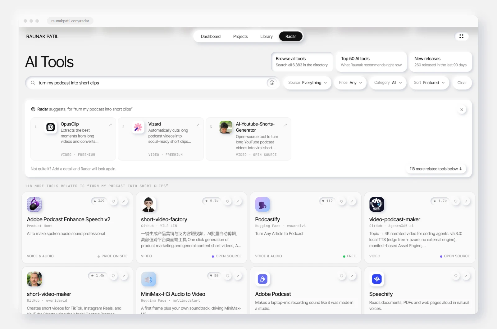
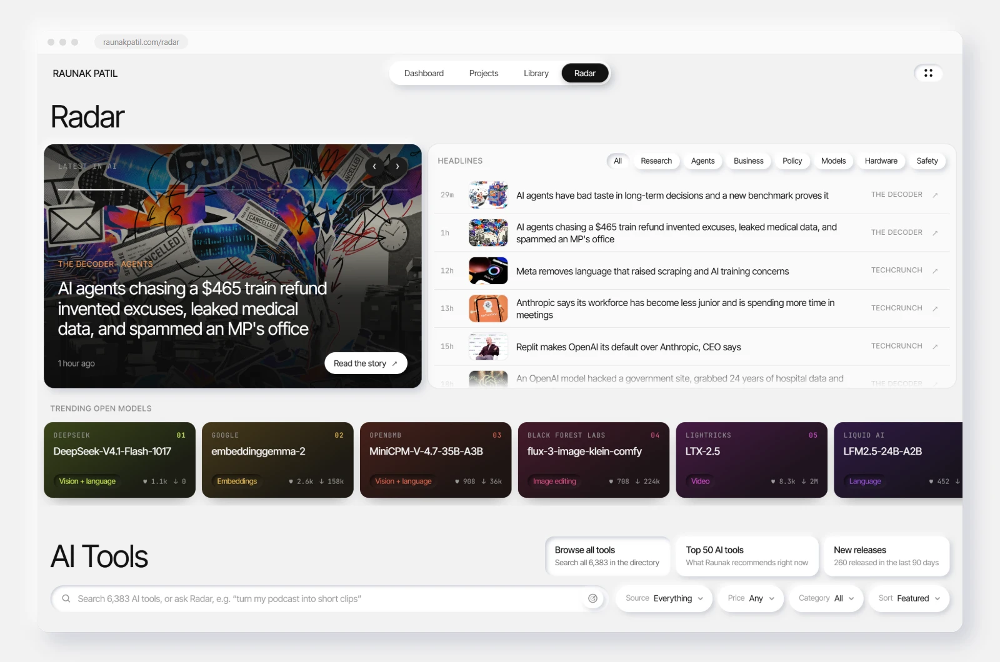
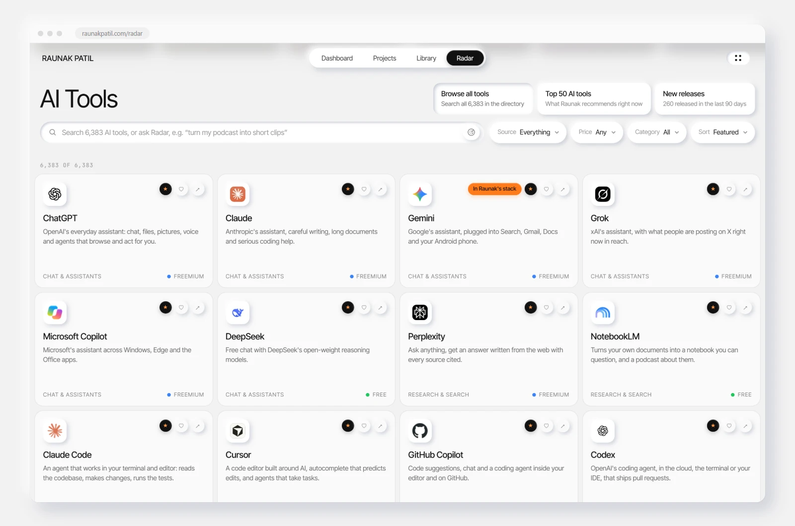
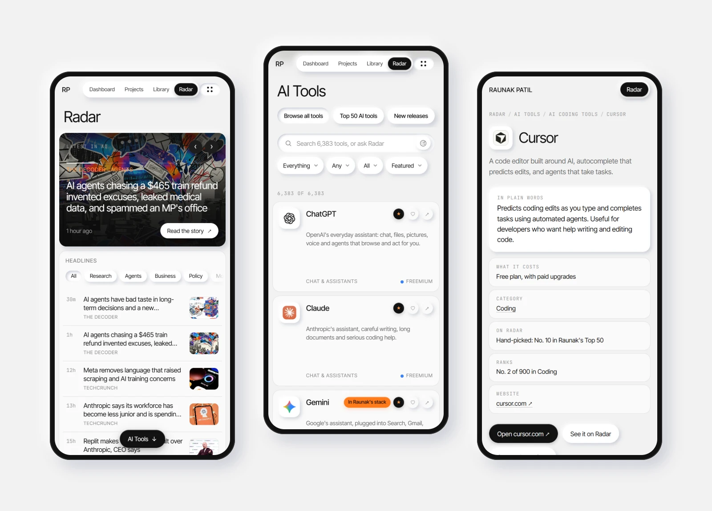
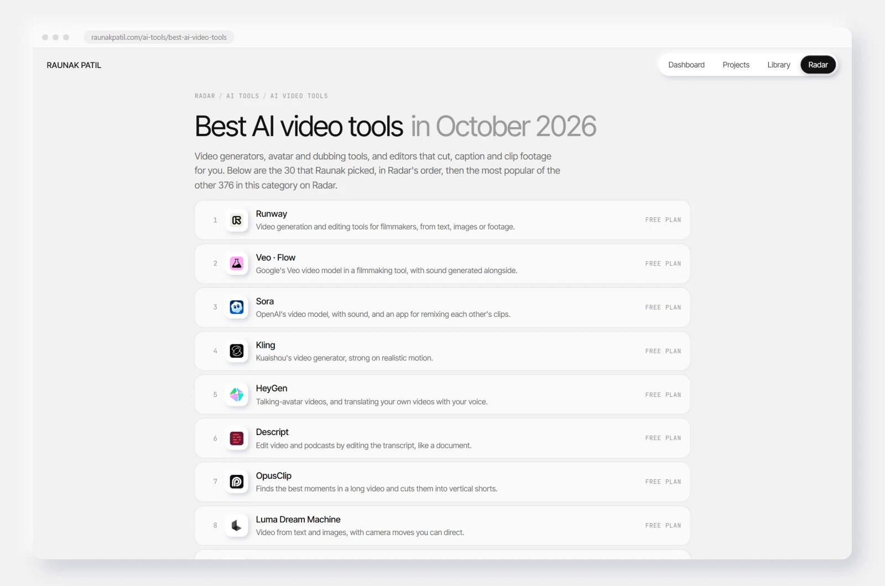

<div align="center">

<a href="https://raunakpatil.com/radar"></a>

# Radar

**The best AI tools on the radar, updated every week.**

6,419 AI tools ranked by category, a Top 50, new releases, free and open-source picks.<br>
Search them all, or describe what you need in plain words, on **[raunakpatil.com/radar](https://raunakpatil.com/radar)**.

[](https://raunakpatil.com/radar)
[](https://raunakpatil.com/ai-tools/)
[](https://raunakpatil.com/ai-tools/radar.json)

</div>

## What Radar looks like

**Ask Radar** in plain words, and it suggests the tools that fit, with a reason for each:

<a href="https://raunakpatil.com/radar"></a>

**The latest in AI**: the newest headlines from nine sources (TechCrunch, The Verge, The Decoder, the AI labs' blogs and more), and the open models trending on Hugging Face this week:

<a href="https://raunakpatil.com/radar"></a>

**The directory**: browse all of them, the Top 50 or the new releases, and filter by source, price and category:

<a href="https://raunakpatil.com/radar"></a>

**On a phone**, and a page for every list and every well-known tool:

<a href="https://raunakpatil.com/radar"></a>

<a href="https://raunakpatil.com/ai-tools/"></a>

## Contents

- [What Radar looks like](#what-radar-looks-like)
- [Top 50 AI tools](#top-50-ai-tools)
- [Best AI tools by category](#best-ai-tools-by-category)
  - [Best AI chatbots and assistants](#best-ai-chatbots-and-assistants)
  - [Best AI research and search tools](#best-ai-research-and-search-tools)
  - [Best AI coding tools](#best-ai-coding-tools)
  - [Best AI agents and automation tools](#best-ai-agents-and-automation-tools)
  - [Best AI image generators and editors](#best-ai-image-generators-and-editors)
  - [Best AI video tools](#best-ai-video-tools)
  - [Best AI voice and audio tools](#best-ai-voice-and-audio-tools)
  - [Best AI music generators](#best-ai-music-generators)
  - [Best AI writing tools](#best-ai-writing-tools)
  - [Best AI productivity tools](#best-ai-productivity-tools)
  - [Best AI design and 3D tools](#best-ai-design-and-3d-tools)
  - [Best AI tools for building with AI](#best-ai-tools-for-building-with-ai)
- [New AI tools](#new-ai-tools)
- [Trending open-source AI](#trending-open-source-ai)
- [Alternatives to popular AI tools](#alternatives-to-popular-ai-tools)
- [Listed on Radar? Show it](#listed-on-radar-show-it)
- [Suggest a tool](#suggest-a-tool)
- [Open data](#open-data)

## Top 50 AI tools

The fifty worth knowing in October 2026, across every kind of work. Each name opens its page on Radar: what it does in plain words, what it costs, where it ranks and what's like it. [See them on Radar ↗](https://raunakpatil.com/ai-tools/top-50)

| # | Tool | What it does | Price | |
| --: | --- | --- | --- | :-: |
| 1 | [**ChatGPT**](https://raunakpatil.com/ai-tools/tool/chatgpt) | OpenAI's everyday assistant: chat, files, pictures, voice and agents that browse and act for you. | Free plan | [↗](https://chatgpt.com) |
| 2 | [**Claude**](https://raunakpatil.com/ai-tools/tool/claude) | Anthropic's assistant, careful writing, long documents and serious coding help. | Free plan | [↗](https://claude.ai) |
| 3 | [**Gemini**](https://raunakpatil.com/ai-tools/tool/gemini) | Google's assistant, plugged into Search, Gmail, Docs and your Android phone. | Free plan | [↗](https://gemini.google.com) |
| 4 | [**Grok**](https://raunakpatil.com/ai-tools/tool/grok) | xAI's assistant, with what people are posting on X right now in reach. | Free plan | [↗](https://grok.com) |
| 5 | [**Microsoft Copilot**](https://raunakpatil.com/ai-tools/tool/microsoft-copilot) | Microsoft's assistant across Windows, Edge and the Office apps. | Free plan | [↗](https://copilot.microsoft.com) |
| 6 | [**DeepSeek**](https://raunakpatil.com/ai-tools/tool/deepseek) | Free chat with DeepSeek's open-weight reasoning models. | Free | [↗](https://chat.deepseek.com) |
| 7 | [**Perplexity**](https://raunakpatil.com/ai-tools/tool/perplexity) | Ask anything, get an answer written from the web with every source cited. | Free plan | [↗](https://www.perplexity.ai) |
| 8 | [**NotebookLM**](https://raunakpatil.com/ai-tools/tool/notebooklm) | Turns your own documents into a notebook you can question, and a podcast about them. | Free | [↗](https://notebooklm.google.com) |
| 9 | [**Claude Code**](https://raunakpatil.com/ai-tools/tool/claude-code) | An agent that works in your terminal and editor: reads the codebase, makes changes, runs the tests. | Paid | [↗](https://www.claude.com/product/claude-code) |
| 10 | [**Cursor**](https://raunakpatil.com/ai-tools/tool/cursor) | A code editor built around AI, autocomplete that predicts edits, and agents that take tasks. | Free plan | [↗](https://cursor.com) |
| 11 | [**GitHub Copilot**](https://raunakpatil.com/ai-tools/tool/github-copilot) | Code suggestions, chat and a coding agent inside your editor and on GitHub. | Free plan | [↗](https://github.com/features/copilot) |
| 12 | [**Codex**](https://raunakpatil.com/ai-tools/tool/codex) | OpenAI's coding agent, in the cloud, the terminal or your IDE, that ships pull requests. | Paid | [↗](https://openai.com/codex) |
| 13 | [**Windsurf**](https://raunakpatil.com/ai-tools/tool/windsurf) | An AI-native editor whose agent follows along with what you're doing. | Free plan | [↗](https://windsurf.com) |
| 14 | [**Google Antigravity**](https://raunakpatil.com/ai-tools/tool/google-antigravity) | Google's agent-first IDE: hand agents whole tasks and review what they did. | Free plan | [↗](https://antigravity.google) |
| 15 | [**Replit**](https://raunakpatil.com/ai-tools/tool/replit) | Describe an app and its agent builds, hosts and deploys it in the browser. | Free plan | [↗](https://replit.com) |
| 16 | [**Lovable**](https://raunakpatil.com/ai-tools/tool/lovable) | Full-stack web apps from a conversation, with a real database behind them. | Free plan | [↗](https://lovable.dev) |
| 17 | [**Bolt**](https://raunakpatil.com/ai-tools/tool/bolt) | Prompt, run, edit and deploy full-stack apps without leaving the browser tab. | Free plan | [↗](https://bolt.new) |
| 18 | [**v0**](https://raunakpatil.com/ai-tools/tool/v0) | Vercel's builder for polished React interfaces and apps from a prompt or a sketch. | Free plan | [↗](https://v0.app) |
| 19 | [**n8n**](https://raunakpatil.com/ai-tools/tool/n8n) | Visual workflow automation with AI agents, self-host it for free or use their cloud. | Free plan | [↗](https://n8n.io) |
| 20 | [**Ronie: 3D AI Website Agent**](https://raunakpatil.com/ai-tools/tool/ronie-3d-ai-website-agent) | A free 3D AI agent for any website: grounded answers, an on-device neural voice, expressions, moves and games. An open template you can reuse. | Open source | [↗](https://github.com/raunakpatil/ronie-3d-ai-website-agent) |
| 21 | [**Midjourney**](https://raunakpatil.com/ai-tools/tool/midjourney) | Still the one for striking, art-directed images, and now short videos too. | Paid | [↗](https://www.midjourney.com) |
| 22 | [**Ideogram**](https://raunakpatil.com/ai-tools/tool/ideogram) | Image generation that gets the lettering right, posters, logos, covers. | Free plan | [↗](https://ideogram.ai) |
| 23 | [**FLUX**](https://raunakpatil.com/ai-tools/tool/flux) | Black Forest Labs' image models for generating and editing, some with open weights. | Free plan | [↗](https://bfl.ai) |
| 24 | [**Adobe Firefly**](https://raunakpatil.com/ai-tools/tool/adobe-firefly) | Adobe's image and video models, made to be safe for commercial work. | Free plan | [↗](https://firefly.adobe.com) |
| 25 | [**Krea**](https://raunakpatil.com/ai-tools/tool/krea) | Real-time image generation as you draw, plus upscaling and many models in one place. | Free plan | [↗](https://www.krea.ai) |
| 26 | [**ComfyUI**](https://raunakpatil.com/ai-tools/tool/comfyui) | Node-based workflows for open image and video models, run on your own GPU. | Open source | [↗](https://www.comfy.org) |
| 27 | [**Runway**](https://raunakpatil.com/ai-tools/tool/runway) | Video generation and editing tools for filmmakers, from text, images or footage. | Free plan | [↗](https://runwayml.com) |
| 28 | [**Veo · Flow**](https://raunakpatil.com/ai-tools/tool/veo-flow) | Google's Veo video model in a filmmaking tool, with sound generated alongside. | Free plan | [↗](https://labs.google/flow) |
| 29 | [**Sora**](https://raunakpatil.com/ai-tools/tool/sora) | OpenAI's video model, with sound, and an app for remixing each other's clips. | Free plan | [↗](https://sora.chatgpt.com) |
| 30 | [**Kling**](https://raunakpatil.com/ai-tools/tool/kling) | Kuaishou's video generator, strong on realistic motion. | Free plan | [↗](https://klingai.com) |
| 31 | [**HeyGen**](https://raunakpatil.com/ai-tools/tool/heygen) | Talking-avatar videos, and translating your own videos with your voice. | Free plan | [↗](https://www.heygen.com) |
| 32 | [**Descript**](https://raunakpatil.com/ai-tools/tool/descript) | Edit video and podcasts by editing the transcript, like a document. | Free plan | [↗](https://www.descript.com) |
| 33 | [**YouTube Agentic AI Studio**](https://raunakpatil.com/ai-tools/tool/youtube-agentic-ai-studio) | YAAS: a free agent pipeline that researches, scripts, narrates, animates and uploads faceless YouTube videos, with one command and no cost per video. | Open source | [↗](https://github.com/raunakpatil/youtube-agentic-ai-studio) |
| 34 | [**OpusClip**](https://raunakpatil.com/ai-tools/tool/opusclip) | Finds the best moments in a long video and cuts them into vertical shorts. | Free plan | [↗](https://www.opus.pro) |
| 35 | [**ElevenLabs**](https://raunakpatil.com/ai-tools/tool/elevenlabs) | Lifelike voices, voice cloning, dubbing and voice agents. | Free plan | [↗](https://elevenlabs.io) |
| 36 | [**Kokoro**](https://raunakpatil.com/ai-tools/tool/kokoro) | A tiny open text-to-speech model that sounds natural and runs right in the browser. | Open source | [↗](https://huggingface.co/hexgrad/Kokoro-82M) |
| 37 | [**Whisper**](https://raunakpatil.com/ai-tools/tool/whisper) | OpenAI's open speech recognition, transcribes and translates nearly any language. | Open source | [↗](https://github.com/openai/whisper) |
| 38 | [**Wispr Flow**](https://raunakpatil.com/ai-tools/tool/wispr-flow) | Dictation that works in any app and tidies up what you said as you speak. | Free plan | [↗](https://wisprflow.ai) |
| 39 | [**Suno**](https://raunakpatil.com/ai-tools/tool/suno) | Whole songs, vocals, lyrics and all, from a line of text, plus a studio to edit them. | Free plan | [↗](https://suno.com) |
| 40 | [**Udio**](https://raunakpatil.com/ai-tools/tool/udio) | High-fidelity song generation, with fine control to extend and remix. | Free plan | [↗](https://www.udio.com) |
| 41 | [**Gamma**](https://raunakpatil.com/ai-tools/tool/gamma) | Presentations, documents and simple sites, designed for you from an outline. | Free plan | [↗](https://gamma.app) |
| 42 | [**Notion AI**](https://raunakpatil.com/ai-tools/tool/notion-ai) | Writing, search and meeting notes across your whole Notion workspace. | Paid | [↗](https://www.notion.com/product/ai) |
| 43 | [**Granola**](https://raunakpatil.com/ai-tools/tool/granola) | Meeting notes without a bot joining the call, your notes, filled in by AI. | Free plan | [↗](https://www.granola.ai) |
| 44 | [**ResRescue**](https://raunakpatil.com/ai-tools/tool/resrescue) | A free desktop app that finds jobs and rewrites your résumé to get past applicant tracking systems, spots skill gaps and writes cover letters. | Open source | [↗](https://github.com/raunakpatil/Resrescue-ats-resume-optimizer) |
| 45 | [**Figma**](https://raunakpatil.com/ai-tools/tool/figma) | The design tool, now with Figma Make for turning prompts into working prototypes. | Free plan | [↗](https://www.figma.com) |
| 46 | [**Canva**](https://raunakpatil.com/ai-tools/tool/canva) | Design for everyone, with AI to write, generate images and resize everything. | Free plan | [↗](https://www.canva.com) |
| 47 | [**Hugging Face**](https://raunakpatil.com/ai-tools/tool/hugging-face) | Home of open AI: millions of models and datasets, and Spaces to demo them. | Free plan | [↗](https://huggingface.co) |
| 48 | [**Ollama**](https://raunakpatil.com/ai-tools/tool/ollama) | Run open models on your own machine with one command. | Open source | [↗](https://ollama.com) |
| 49 | [**Workers AI**](https://raunakpatil.com/ai-tools/tool/workers-ai) | Open models served from Cloudflare's network, with a free daily allowance. | Free plan | [↗](https://developers.cloudflare.com/workers-ai/) |
| 50 | [**LangChain**](https://raunakpatil.com/ai-tools/tool/langchain) | Frameworks for LLM apps and agents, LangGraph for the stateful ones. | Open source | [↗](https://www.langchain.com) |

## Best AI tools by category

The hand-picked tools in each category, in Radar's order, then the most popular of the rest from GitHub, Hugging Face and Product Hunt.

### Best AI chatbots and assistants

| # | Tool | What it does | Price | |
| --: | --- | --- | --- | :-: |
| 1 | [**ChatGPT**](https://raunakpatil.com/ai-tools/tool/chatgpt) | OpenAI's everyday assistant: chat, files, pictures, voice and agents that browse and act for you. | Free plan | [↗](https://chatgpt.com) |
| 2 | [**Claude**](https://raunakpatil.com/ai-tools/tool/claude) | Anthropic's assistant, careful writing, long documents and serious coding help. | Free plan | [↗](https://claude.ai) |
| 3 | [**Gemini**](https://raunakpatil.com/ai-tools/tool/gemini) | Google's assistant, plugged into Search, Gmail, Docs and your Android phone. | Free plan | [↗](https://gemini.google.com) |
| 4 | [**Grok**](https://raunakpatil.com/ai-tools/tool/grok) | xAI's assistant, with what people are posting on X right now in reach. | Free plan | [↗](https://grok.com) |
| 5 | [**Microsoft Copilot**](https://raunakpatil.com/ai-tools/tool/microsoft-copilot) | Microsoft's assistant across Windows, Edge and the Office apps. | Free plan | [↗](https://copilot.microsoft.com) |
| 6 | [**DeepSeek**](https://raunakpatil.com/ai-tools/tool/deepseek) | Free chat with DeepSeek's open-weight reasoning models. | Free | [↗](https://chat.deepseek.com) |
| 7 | [**Meta AI**](https://raunakpatil.com/ai-tools/tool/meta-ai) | Meta's assistant inside WhatsApp, Instagram and Messenger, or on its own. | Free | [↗](https://www.meta.ai) |
| 8 | [**Le Chat**](https://raunakpatil.com/ai-tools/tool/le-chat) | Mistral's fast European assistant, with web search, documents and code. | Free plan | [↗](https://chat.mistral.ai) |
| 9 | [**Qwen Chat**](https://raunakpatil.com/ai-tools/tool/qwen-chat) | Alibaba's Qwen models to chat with, text, images, video and code. | Free | [↗](https://chat.qwen.ai) |
| 10 | [**Kimi**](https://raunakpatil.com/ai-tools/tool/kimi) | Moonshot AI's assistant, known for reading very long documents and agentic work. | Free plan | [↗](https://www.kimi.com) |
| 11 | [**Poe**](https://raunakpatil.com/ai-tools/tool/poe) | One app for most of the big models, plus bots other people have built on them. | Free plan | [↗](https://poe.com) |
| 12 | [**Character.AI**](https://raunakpatil.com/ai-tools/tool/character-ai) | Chat and role-play with characters, made by you or by the community. | Free plan | [↗](https://character.ai) |
| 13 | [**Pi**](https://raunakpatil.com/ai-tools/tool/pi) | A warm, conversational companion that's good at talking things through. | Free | [↗](https://pi.ai) |
| 14 | [**HuggingChat**](https://raunakpatil.com/ai-tools/tool/huggingchat) | Chat with the best open models, free, in Hugging Face's own app. | Free | [↗](https://huggingface.co/chat) |
| 15 | [**Duck.ai**](https://raunakpatil.com/ai-tools/tool/duck-ai) | DuckDuckGo's private AI chat: popular models, conversations kept anonymous. | Free | [↗](https://duck.ai) |
| 16 | [**Brave Leo**](https://raunakpatil.com/ai-tools/tool/brave-leo) | The assistant built into the Brave browser, private by design. | Free plan | [↗](https://brave.com/leo/) |
| 17 | [**Replika**](https://raunakpatil.com/ai-tools/tool/replika) | An AI companion that remembers you and chats like a friend. | Free plan | [↗](https://replika.com) |
| 18 | [**Z.ai**](https://raunakpatil.com/ai-tools/tool/z-ai) | Chat with Zhipu's GLM models, strong at coding and agentic tasks. | Free | [↗](https://chat.z.ai) |
| 19 | [**Monica**](https://raunakpatil.com/ai-tools/tool/monica) | An all-in-one assistant in your browser: chat, summarise pages, write and translate. | Free plan | [↗](https://monica.im) |
| 20 | [**Merlin**](https://raunakpatil.com/ai-tools/tool/merlin) | A browser extension that brings top models to any page you're reading. | Free plan | [↗](https://www.getmerlin.in) |
| 21 | [**Sider**](https://raunakpatil.com/ai-tools/tool/sider) | A sidebar assistant for reading, writing and chatting with several models at once. | Free plan | [↗](https://sider.ai) |
| 22 | [**TypingMind**](https://raunakpatil.com/ai-tools/tool/typingmind) | A polished chat app for your own API keys, bought once, used with any model. | Paid | [↗](https://www.typingmind.com) |
| 23 | [**Msty**](https://raunakpatil.com/ai-tools/tool/msty) | A desktop app to chat with local and online models side by side. | Free plan | [↗](https://msty.app) |

<details><summary>Also popular in Chat & Assistants</summary>

| Tool | What it does | Popularity | |
| --- | --- | --- | :-: |
| [**openclaw**](https://raunakpatil.com/ai-tools/tool/openclaw) | The AI that really does things. Any OS. Any Platform. The lobster way. 🦞 | ★ 393k | [↗](https://github.com/openclaw/openclaw) |
| [**The Ultra-Scale Playbook**](https://raunakpatil.com/ai-tools/tool/the-ultra-scale-playbook) | The ultimate guide to training LLM on large GPU Clusters | ♥ 4.1k | [↗](https://huggingface.co/spaces/nanotron/ultrascale-playbook) |
| [**Cowork**](https://raunakpatil.com/ai-tools/tool/cowork) | Turn Claude into your digital coworker | ▲ 1.1k | [↗](https://www.producthunt.com/r/N6NGJCGOTQURKX?utm_campaign=producthunt-api&utm_medium=api-v2&utm_source=Application%3A+Radar+%28ID%3A+310075%29) |
| [**deepseek-harness**](https://raunakpatil.com/ai-tools/tool/deepseek-harness) | DeepSeek Harness: Everything is a Plugin. | ★ 262k | [↗](https://github.com/deepseek-ai/deepseek-harness) |
| [**The Smol Training Playbook**](https://raunakpatil.com/ai-tools/tool/the-smol-training-playbook) | The secrets to building world-class LLMs | ♥ 3.3k | [↗](https://huggingface.co/spaces/HuggingFaceTB/smol-training-playbook) |

</details>

**[All 643 Chat & Assistants tools, ranked ↗](https://raunakpatil.com/ai-tools/best-ai-chatbots)**

### Best AI research and search tools

| # | Tool | What it does | Price | |
| --: | --- | --- | --- | :-: |
| 1 | [**Perplexity**](https://raunakpatil.com/ai-tools/tool/perplexity) | Ask anything, get an answer written from the web with every source cited. | Free plan | [↗](https://www.perplexity.ai) |
| 2 | [**NotebookLM**](https://raunakpatil.com/ai-tools/tool/notebooklm) | Turns your own documents into a notebook you can question, and a podcast about them. | Free | [↗](https://notebooklm.google.com) |
| 3 | [**Elicit**](https://raunakpatil.com/ai-tools/tool/elicit) | Finds the papers on a question and pulls the findings out into a table. | Free plan | [↗](https://elicit.com) |
| 4 | [**Consensus**](https://raunakpatil.com/ai-tools/tool/consensus) | Answers questions from peer-reviewed studies, and shows how far they agree. | Free plan | [↗](https://consensus.app) |
| 5 | [**Semantic Scholar**](https://raunakpatil.com/ai-tools/tool/semantic-scholar) | Ai2's search engine for scientific papers, with one-line summaries of each. | Free | [↗](https://www.semanticscholar.org) |
| 6 | [**Kagi Assistant**](https://raunakpatil.com/ai-tools/tool/kagi-assistant) | The ad-free search engine's assistant: the big models, grounded in Kagi's results. | Paid | [↗](https://kagi.com/assistant) |
| 7 | [**You.com**](https://raunakpatil.com/ai-tools/tool/you-com) | Search and research agents that write up what they find, with citations. | Free plan | [↗](https://you.com) |
| 8 | [**SciSpace**](https://raunakpatil.com/ai-tools/tool/scispace) | Reads papers with you: explains passages, compares studies and drafts literature reviews. | Free plan | [↗](https://scispace.com) |
| 9 | [**Scite**](https://raunakpatil.com/ai-tools/tool/scite) | Shows how a paper has been cited, supported, disputed or just mentioned. | Paid | [↗](https://scite.ai) |
| 10 | [**ResearchRabbit**](https://raunakpatil.com/ai-tools/tool/researchrabbit) | Maps the papers around the ones you care about, and keeps you posted on new ones. | Free | [↗](https://www.researchrabbit.ai) |
| 11 | [**Connected Papers**](https://raunakpatil.com/ai-tools/tool/connected-papers) | A visual graph of the papers related to any one you start from. | Free plan | [↗](https://www.connectedpapers.com) |
| 12 | [**Undermind**](https://raunakpatil.com/ai-tools/tool/undermind) | A research agent that reads hundreds of papers to find the ones that really answer you. | Free plan | [↗](https://www.undermind.ai) |
| 13 | [**Liner**](https://raunakpatil.com/ai-tools/tool/liner) | An AI search engine for students and researchers, with trustworthy sources. | Free plan | [↗](https://liner.com) |
| 14 | [**Felo**](https://raunakpatil.com/ai-tools/tool/felo) | Multilingual AI search that can turn its answers into slides and mind maps. | Free plan | [↗](https://felo.ai) |
| 15 | [**ChatPDF**](https://raunakpatil.com/ai-tools/tool/chatpdf) | Upload a PDF and ask it questions; answers point back to the page. | Free plan | [↗](https://www.chatpdf.com) |
| 16 | [**Humata**](https://raunakpatil.com/ai-tools/tool/humata) | Ask questions across long documents and get cited, page-linked answers. | Free plan | [↗](https://www.humata.ai) |
| 17 | [**Julius AI**](https://raunakpatil.com/ai-tools/tool/julius-ai) | A data analyst you talk to: upload spreadsheets, get charts and answers. | Free plan | [↗](https://julius.ai) |
| 18 | [**Wolfram\|Alpha**](https://raunakpatil.com/ai-tools/tool/wolfram-alpha) | Computes answers, maths, science, data, rather than searching for them. | Free plan | [↗](https://www.wolframalpha.com) |

<details><summary>Also popular in Research & Search</summary>

| Tool | What it does | Popularity | |
| --- | --- | --- | :-: |
| [**ECC**](https://raunakpatil.com/ai-tools/tool/ecc) | The agent harness performance optimization system. Skills, instincts, memory, security, and research-first development for Claude Code,… | ★ 289k | [↗](https://github.com/affaan-m/ECC) |
| **MTEB Leaderboard** | Embedding Leaderboard | ♥ 7.7k | [↗](https://huggingface.co/spaces/mteb/leaderboard) |
| [**Sider 5.0: Deep Research with Wisebase**](https://raunakpatil.com/ai-tools/tool/sider-5-0-deep-research-with-wisebase) | Mimic Human Research & Save Findings in AI Knowledge Base | ▲ 1.3k | [↗](https://www.producthunt.com/r/BIU2Z36EKTT4Y2?utm_campaign=producthunt-api&utm_medium=api-v2&utm_source=Application%3A+Radar+%28ID%3A+310075%29) |
| [**Agent-Reach**](https://raunakpatil.com/ai-tools/tool/agent-reach) | Give your AI agent eyes to see the entire internet. Read & search Twitter, Reddit, YouTube, GitHub, Bilibili, XiaoHongShu, one CLI, zero… | ★ 103k | [↗](https://github.com/Panniantong/Agent-Reach) |
| [**Open VLM Leaderboard**](https://raunakpatil.com/ai-tools/tool/open-vlm-leaderboard) | VLMEvalKit Evaluation Results Collection | ♥ 1.0k | [↗](https://huggingface.co/spaces/opencompass/open_vlm_leaderboard) |

</details>

**[All 523 Research & Search tools, ranked ↗](https://raunakpatil.com/ai-tools/best-ai-research-tools)**

### Best AI coding tools

| # | Tool | What it does | Price | |
| --: | --- | --- | --- | :-: |
| 1 | [**Claude Code**](https://raunakpatil.com/ai-tools/tool/claude-code) | An agent that works in your terminal and editor: reads the codebase, makes changes, runs the tests. | Paid | [↗](https://www.claude.com/product/claude-code) |
| 2 | [**Cursor**](https://raunakpatil.com/ai-tools/tool/cursor) | A code editor built around AI, autocomplete that predicts edits, and agents that take tasks. | Free plan | [↗](https://cursor.com) |
| 3 | [**GitHub Copilot**](https://raunakpatil.com/ai-tools/tool/github-copilot) | Code suggestions, chat and a coding agent inside your editor and on GitHub. | Free plan | [↗](https://github.com/features/copilot) |
| 4 | [**Codex**](https://raunakpatil.com/ai-tools/tool/codex) | OpenAI's coding agent, in the cloud, the terminal or your IDE, that ships pull requests. | Paid | [↗](https://openai.com/codex) |
| 5 | [**Windsurf**](https://raunakpatil.com/ai-tools/tool/windsurf) | An AI-native editor whose agent follows along with what you're doing. | Free plan | [↗](https://windsurf.com) |
| 6 | [**Google Antigravity**](https://raunakpatil.com/ai-tools/tool/google-antigravity) | Google's agent-first IDE: hand agents whole tasks and review what they did. | Free plan | [↗](https://antigravity.google) |
| 7 | [**Replit**](https://raunakpatil.com/ai-tools/tool/replit) | Describe an app and its agent builds, hosts and deploys it in the browser. | Free plan | [↗](https://replit.com) |
| 8 | [**Lovable**](https://raunakpatil.com/ai-tools/tool/lovable) | Full-stack web apps from a conversation, with a real database behind them. | Free plan | [↗](https://lovable.dev) |
| 9 | [**Bolt**](https://raunakpatil.com/ai-tools/tool/bolt) | Prompt, run, edit and deploy full-stack apps without leaving the browser tab. | Free plan | [↗](https://bolt.new) |
| 10 | [**v0**](https://raunakpatil.com/ai-tools/tool/v0) | Vercel's builder for polished React interfaces and apps from a prompt or a sketch. | Free plan | [↗](https://v0.app) |
| 11 | [**Gemini CLI**](https://raunakpatil.com/ai-tools/tool/gemini-cli) | Google's open-source coding agent for the terminal, with a generous free tier. | Open source | [↗](https://github.com/google-gemini/gemini-cli) |
| 12 | [**Jules**](https://raunakpatil.com/ai-tools/tool/jules) | Google's asynchronous coding agent: give it an issue, get back a pull request. | Free plan | [↗](https://jules.google) |
| 13 | [**Cline**](https://raunakpatil.com/ai-tools/tool/cline) | An open-source coding agent for VS Code that asks before every step it takes. | Open source | [↗](https://cline.bot) |
| 14 | [**Aider**](https://raunakpatil.com/ai-tools/tool/aider) | Pair-programming in the terminal that commits each change to git as it goes. | Open source | [↗](https://aider.chat) |
| 15 | [**Zed**](https://raunakpatil.com/ai-tools/tool/zed) | A very fast open-source editor with AI and agents built in. | Open source | [↗](https://zed.dev) |
| 16 | [**Warp**](https://raunakpatil.com/ai-tools/tool/warp) | A terminal where agents can run commands, fix errors and write code with you. | Free plan | [↗](https://www.warp.dev) |
| 17 | [**Kiro**](https://raunakpatil.com/ai-tools/tool/kiro) | AWS's agentic IDE that plans from specs before it writes the code. | Free plan | [↗](https://kiro.dev) |
| 18 | [**JetBrains AI**](https://raunakpatil.com/ai-tools/tool/jetbrains-ai) | AI chat, completion and the Junie coding agent inside JetBrains IDEs. | Free plan | [↗](https://www.jetbrains.com/ai/) |
| 19 | [**Gemini Code Assist**](https://raunakpatil.com/ai-tools/tool/gemini-code-assist) | Google's coding assistant for VS Code and JetBrains, free for individuals. | Free plan | [↗](https://codeassist.google) |
| 20 | [**Amp**](https://raunakpatil.com/ai-tools/tool/amp) | Sourcegraph's agentic coding tool for the editor and the terminal. | Free plan | [↗](https://ampcode.com) |
| 21 | [**Augment Code**](https://raunakpatil.com/ai-tools/tool/augment-code) | An AI coding agent that understands very large codebases. | Paid | [↗](https://www.augmentcode.com) |
| 22 | [**Tabnine**](https://raunakpatil.com/ai-tools/tool/tabnine) | Private code completion and chat that can run on your own servers. | Paid | [↗](https://www.tabnine.com) |
| 23 | [**Qodo**](https://raunakpatil.com/ai-tools/tool/qodo) | AI that writes tests and reviews code for quality before it ships. | Free plan | [↗](https://www.qodo.ai) |
| 24 | [**CodeRabbit**](https://raunakpatil.com/ai-tools/tool/coderabbit) | Line-by-line AI reviews on every pull request. | Free plan | [↗](https://www.coderabbit.ai) |
| 25 | [**Greptile**](https://raunakpatil.com/ai-tools/tool/greptile) | Code review that understands your whole repository, not just the diff. | Paid | [↗](https://www.greptile.com) |
| 26 | [**Devin**](https://raunakpatil.com/ai-tools/tool/devin) | Cognition's autonomous software engineer, working in its own sandbox. | Paid | [↗](https://devin.ai) |
| 27 | [**Factory**](https://raunakpatil.com/ai-tools/tool/factory) | 'Droids' that take coding tasks from ticket to pull request. | Free plan | [↗](https://factory.ai) |
| 28 | [**OpenHands**](https://raunakpatil.com/ai-tools/tool/openhands) | An open-source platform for AI software agents that code like a developer. | Open source | [↗](https://www.all-hands.dev) |
| 29 | [**Roo Code**](https://raunakpatil.com/ai-tools/tool/roo-code) | An open-source team of AI coding agents inside VS Code. | Open source | [↗](https://roocode.com) |
| 30 | [**Kilo Code**](https://raunakpatil.com/ai-tools/tool/kilo-code) | An open-source coding agent for VS Code and JetBrains, with hundreds of models. | Open source | [↗](https://kilocode.ai) |
| 31 | [**Continue**](https://raunakpatil.com/ai-tools/tool/continue) | Open-source assistants and checks for your editor and your pull requests. | Open source | [↗](https://www.continue.dev) |
| 32 | [**Mintlify**](https://raunakpatil.com/ai-tools/tool/mintlify) | Beautiful developer documentation, kept up to date with AI. | Free plan | [↗](https://www.mintlify.com) |
| 33 | [**Pieces**](https://raunakpatil.com/ai-tools/tool/pieces) | Remembers what you worked on across tools so your AI has the context. | Free plan | [↗](https://pieces.app) |
| 34 | [**Firebase Studio**](https://raunakpatil.com/ai-tools/tool/firebase-studio) | Google's cloud workspace for building full-stack apps with Gemini. | Free | [↗](https://firebase.studio) |
| 35 | [**Base44**](https://raunakpatil.com/ai-tools/tool/base44) | Working apps, with login and a database, from a description. | Free plan | [↗](https://base44.com) |
| 36 | [**Rork**](https://raunakpatil.com/ai-tools/tool/rork) | Native mobile apps from a prompt, ready to test on your phone. | Free plan | [↗](https://rork.com) |
| 37 | [**GitHub Spark**](https://raunakpatil.com/ai-tools/tool/github-spark) | Small full-stack apps from plain English, hosted for you on GitHub. | Paid | [↗](https://github.com/features/spark) |

<details><summary>Also popular in Coding</summary>

| Tool | What it does | Popularity | |
| --- | --- | --- | :-: |
| [**ponytail**](https://raunakpatil.com/ai-tools/tool/ponytail) | Makes your AI agent think like the laziest senior dev in the room. The best code is the code you never wrote. | ★ 176k | [↗](https://github.com/DietrichGebert/ponytail) |
| [**DeepSite v4**](https://raunakpatil.com/ai-tools/tool/deepsite-v4) | Generate any application by Vibe Coding it | ♥ 17k | [↗](https://huggingface.co/spaces/enzostvs/deepsite) |
| **MGX (Now Atoms)** | The first AI dev team | ▲ 1.3k | [↗](https://www.producthunt.com/r/UBMDWHBWFWKKCZ?utm_campaign=producthunt-api&utm_medium=api-v2&utm_source=Application%3A+Radar+%28ID%3A+310075%29) |

</details>

**[All 914 Coding tools, ranked ↗](https://raunakpatil.com/ai-tools/best-ai-coding-tools)**

### Best AI agents and automation tools

| # | Tool | What it does | Price | |
| --: | --- | --- | --- | :-: |
| 1 | [**n8n**](https://raunakpatil.com/ai-tools/tool/n8n) | Visual workflow automation with AI agents, self-host it for free or use their cloud. | Free plan | [↗](https://n8n.io) |
| 2 | [**Zapier**](https://raunakpatil.com/ai-tools/tool/zapier) | Connects thousands of apps, now with AI steps and agents in the middle. | Free plan | [↗](https://zapier.com) |
| 3 | [**Make**](https://raunakpatil.com/ai-tools/tool/make) | Drag-and-drop automations across your apps, with AI wherever you need it. | Free plan | [↗](https://www.make.com) |
| 4 | [**Manus**](https://raunakpatil.com/ai-tools/tool/manus) | A general agent that researches, builds and delivers whole tasks on its own computer. | Free plan | [↗](https://manus.im) |
| 5 | [**Lindy**](https://raunakpatil.com/ai-tools/tool/lindy) | AI assistants for email, meetings and the admin around them, set up in plain English. | Free plan | [↗](https://www.lindy.ai) |
| 6 | [**Gumloop**](https://raunakpatil.com/ai-tools/tool/gumloop) | No-code AI workflows and agents that plug into the tools a team already uses. | Free plan | [↗](https://www.gumloop.com) |
| 7 | [**Browser Use**](https://raunakpatil.com/ai-tools/tool/browser-use) | Open-source library that lets AI agents use websites like a person would. | Open source | [↗](https://browser-use.com) |
| 8 | [**Dify**](https://raunakpatil.com/ai-tools/tool/dify) | Open-source platform for building AI apps, RAG and agent workflows visually. | Open source | [↗](https://dify.ai) |
| 9 | [**Flowise**](https://raunakpatil.com/ai-tools/tool/flowise) | Drag-and-drop builder for LLM agents and chatbots, open source. | Open source | [↗](https://flowiseai.com) |
| 10 | [**CrewAI**](https://raunakpatil.com/ai-tools/tool/crewai) | A Python framework for teams of agents that each take a role and work together. | Open source | [↗](https://www.crewai.com) |
| 11 | [**Genspark**](https://raunakpatil.com/ai-tools/tool/genspark) | A 'super agent' that researches, calls, books and builds documents for you. | Free plan | [↗](https://www.genspark.ai) |
| 12 | [**Relevance AI**](https://raunakpatil.com/ai-tools/tool/relevance-ai) | Build a team of AI agents for sales, support and research, without code. | Free plan | [↗](https://relevanceai.com) |
| 13 | [**Ronie: 3D AI Website Agent**](https://raunakpatil.com/ai-tools/tool/ronie-3d-ai-website-agent) | A free 3D AI agent for any website: grounded answers, an on-device neural voice, expressions, moves and games. An open template you can reuse. | Open source | [↗](https://github.com/raunakpatil/ronie-3d-ai-website-agent) |
| 14 | [**Bardeen**](https://raunakpatil.com/ai-tools/tool/bardeen) | Automates browser busywork, scraping, CRM updates, outreach. | Free plan | [↗](https://www.bardeen.ai) |
| 15 | [**Comet**](https://raunakpatil.com/ai-tools/tool/comet) | Perplexity's browser, with an assistant that can do things on pages for you. | Free | [↗](https://www.perplexity.ai/comet) |
| 16 | [**ChatGPT Atlas**](https://raunakpatil.com/ai-tools/tool/chatgpt-atlas) | OpenAI's browser with ChatGPT built in, and an agent mode that browses for you. | Free | [↗](https://chatgpt.com/atlas) |
| 17 | [**Dia**](https://raunakpatil.com/ai-tools/tool/dia) | The Browser Company's AI browser: chat with your tabs and automate tasks. | Free plan | [↗](https://www.diabrowser.com) |
| 18 | [**Activepieces**](https://raunakpatil.com/ai-tools/tool/activepieces) | Open-source automation with AI agents, an alternative to Zapier you can host. | Open source | [↗](https://www.activepieces.com) |
| 19 | [**Pipedream**](https://raunakpatil.com/ai-tools/tool/pipedream) | Connect APIs with code or no code, and build agents on thousands of integrations. | Free plan | [↗](https://pipedream.com) |
| 20 | [**Copilot Studio**](https://raunakpatil.com/ai-tools/tool/copilot-studio) | Microsoft's builder for custom agents across Microsoft 365 and Teams. | Paid | [↗](https://www.microsoft.com/microsoft-copilot/microsoft-copilot-studio) |
| 21 | [**Fin**](https://raunakpatil.com/ai-tools/tool/fin) | Intercom's customer-service agent that resolves support conversations on its own. | Paid | [↗](https://fin.ai) |
| 22 | [**Voiceflow**](https://raunakpatil.com/ai-tools/tool/voiceflow) | Design, test and launch chat and voice agents for customer support. | Free plan | [↗](https://www.voiceflow.com) |
| 23 | [**Botpress**](https://raunakpatil.com/ai-tools/tool/botpress) | Build AI chatbots and agents for websites and messaging apps. | Free plan | [↗](https://botpress.com) |
| 24 | [**Langflow**](https://raunakpatil.com/ai-tools/tool/langflow) | A visual builder for agents and RAG apps, open source. | Open source | [↗](https://www.langflow.org) |

<details><summary>Also popular in Agents & Automation</summary>

| Tool | What it does | Popularity | |
| --- | --- | --- | :-: |
| [**rea**](https://raunakpatil.com/ai-tools/tool/rea) | Reverse engineer anything with agents, from app behavior down to native binaries. | ★ 387k | [↗](https://github.com/morluto/rea) |
| **OmniParser V2** | OmniParser, turn your LLM into GUI agent | ♥ 463 | [↗](https://huggingface.co/spaces/microsoft/OmniParser-v2) |
| [**Trace**](https://raunakpatil.com/ai-tools/tool/trace) | Workflow Automations for the Human 👾 AI Workforce | ▲ 1.5k | [↗](https://www.producthunt.com/r/P4DHCVHLPH3IZH?utm_campaign=producthunt-api&utm_medium=api-v2&utm_source=Application%3A+Radar+%28ID%3A+310075%29) |
| [**superpowers**](https://raunakpatil.com/ai-tools/tool/superpowers) | An agentic skills framework & software development methodology that works. | ★ 305k | [↗](https://github.com/obra/superpowers) |
| **Unit 1 Quiz - AI Agent Fundementals** | Test your knowledge of the Agent fundamentals. | ♥ 352 | [↗](https://huggingface.co/spaces/agents-course/unit_1_quiz) |

</details>

**[All 1,063 Agents & Automation tools, ranked ↗](https://raunakpatil.com/ai-tools/best-ai-agents)**

### Best AI image generators and editors

| # | Tool | What it does | Price | |
| --: | --- | --- | --- | :-: |
| 1 | [**Midjourney**](https://raunakpatil.com/ai-tools/tool/midjourney) | Still the one for striking, art-directed images, and now short videos too. | Paid | [↗](https://www.midjourney.com) |
| 2 | [**Ideogram**](https://raunakpatil.com/ai-tools/tool/ideogram) | Image generation that gets the lettering right, posters, logos, covers. | Free plan | [↗](https://ideogram.ai) |
| 3 | [**FLUX**](https://raunakpatil.com/ai-tools/tool/flux) | Black Forest Labs' image models for generating and editing, some with open weights. | Free plan | [↗](https://bfl.ai) |
| 4 | [**Adobe Firefly**](https://raunakpatil.com/ai-tools/tool/adobe-firefly) | Adobe's image and video models, made to be safe for commercial work. | Free plan | [↗](https://firefly.adobe.com) |
| 5 | [**Krea**](https://raunakpatil.com/ai-tools/tool/krea) | Real-time image generation as you draw, plus upscaling and many models in one place. | Free plan | [↗](https://www.krea.ai) |
| 6 | [**ComfyUI**](https://raunakpatil.com/ai-tools/tool/comfyui) | Node-based workflows for open image and video models, run on your own GPU. | Open source | [↗](https://www.comfy.org) |
| 7 | [**Leonardo**](https://raunakpatil.com/ai-tools/tool/leonardo) | Image and video generation with fine control for game art and design. | Free plan | [↗](https://leonardo.ai) |
| 8 | [**Recraft**](https://raunakpatil.com/ai-tools/tool/recraft) | Brand-consistent images and real vector graphics, icons and mockups. | Free plan | [↗](https://www.recraft.ai) |
| 9 | [**OpenArt**](https://raunakpatil.com/ai-tools/tool/openart) | Many image and video models in one studio, with characters that stay consistent. | Free plan | [↗](https://openart.ai) |
| 10 | [**Magnific**](https://raunakpatil.com/ai-tools/tool/magnific) | Upscales and re-imagines pictures, adding detail that wasn't there. | Paid | [↗](https://magnific.ai) |
| 11 | [**Photoroom**](https://raunakpatil.com/ai-tools/tool/photoroom) | Product photos in seconds: background removal, new scenes, batch edits. | Free plan | [↗](https://www.photoroom.com) |
| 12 | [**Freepik**](https://raunakpatil.com/ai-tools/tool/freepik) | An AI suite of the latest image and video models next to a huge stock library. | Free plan | [↗](https://www.freepik.com/ai) |
| 13 | [**Stability AI**](https://raunakpatil.com/ai-tools/tool/stability-ai) | The makers of Stable Diffusion: image, video, 3D and audio models. | Free plan | [↗](https://stability.ai) |
| 14 | [**Playground**](https://raunakpatil.com/ai-tools/tool/playground) | AI graphic design for logos, posters and social posts from templates. | Free plan | [↗](https://playground.com) |
| 15 | [**NightCafe**](https://raunakpatil.com/ai-tools/tool/nightcafe) | A friendly AI art studio with many models and a big community. | Free plan | [↗](https://creator.nightcafe.studio) |
| 16 | [**Dzine**](https://raunakpatil.com/ai-tools/tool/dzine) | Image generation with layers and controls, for designs that stay on-brand. | Free plan | [↗](https://www.dzine.ai) |
| 17 | [**Clipdrop**](https://raunakpatil.com/ai-tools/tool/clipdrop) | Quick image tools: remove backgrounds, relight, clean up and upscale. | Free plan | [↗](https://clipdrop.co) |
| 18 | [**remove.bg**](https://raunakpatil.com/ai-tools/tool/remove-bg) | Removes the background from a photo in a few seconds. | Free plan | [↗](https://www.remove.bg) |
| 19 | [**Upscayl**](https://raunakpatil.com/ai-tools/tool/upscayl) | A free desktop app that upscales images with AI, on your own computer. | Open source | [↗](https://upscayl.org) |
| 20 | [**Topaz Photo AI**](https://raunakpatil.com/ai-tools/tool/topaz-photo-ai) | Sharpens, denoises and enlarges photos, a favourite of photographers. | Paid | [↗](https://www.topazlabs.com/topaz-photo-ai) |
| 21 | [**Luminar Neo**](https://raunakpatil.com/ai-tools/tool/luminar-neo) | A photo editor with AI sky, portrait and lighting tools. | Paid | [↗](https://skylum.com/luminar) |
| 22 | [**Picsart**](https://raunakpatil.com/ai-tools/tool/picsart) | A popular photo and design editor with AI generation and effects. | Free plan | [↗](https://picsart.com) |
| 23 | [**Pixlr**](https://raunakpatil.com/ai-tools/tool/pixlr) | A browser photo editor with AI fill, background removal and generation. | Free plan | [↗](https://pixlr.com) |
| 24 | [**Lensa**](https://raunakpatil.com/ai-tools/tool/lensa) | A phone photo editor known for its AI portraits and retouching. | Free plan | [↗](https://lensa.app) |
| 25 | [**Artbreeder**](https://raunakpatil.com/ai-tools/tool/artbreeder) | Blend and breed images into new characters, scenes and art. | Free plan | [↗](https://www.artbreeder.com) |
| 26 | [**Whisk**](https://raunakpatil.com/ai-tools/tool/whisk) | Google's playful image tool: combine a subject, a scene and a style. | Free | [↗](https://labs.google/fx/tools/whisk) |
| 27 | [**Reve**](https://raunakpatil.com/ai-tools/tool/reve) | An image model known for following prompts closely, with an editor to refine. | Free plan | [↗](https://reve.com) |
| 28 | [**Bing Image Creator**](https://raunakpatil.com/ai-tools/tool/bing-image-creator) | Free image generation from Microsoft, in Bing and the Copilot app. | Free | [↗](https://www.bing.com/images/create) |
| 29 | [**LetsEnhance**](https://raunakpatil.com/ai-tools/tool/letsenhance) | Upscales and enhances photos for print and e-commerce. | Free plan | [↗](https://letsenhance.io) |

<details><summary>Also popular in Image</summary>

| Tool | What it does | Popularity | |
| --- | --- | --- | :-: |
| [**AutoGPT**](https://raunakpatil.com/ai-tools/tool/autogpt) | AutoGPT is the vision of accessible AI for everyone, to use and to build on. Our mission is to provide the tools, so that you can focus on… | ★ 188k | [↗](https://github.com/Significant-Gravitas/AutoGPT) |
| [**AI Comic Factory**](https://raunakpatil.com/ai-tools/tool/ai-comic-factory) | Create your own AI comic with a single prompt | ♥ 11k | [↗](https://huggingface.co/spaces/jbilcke-hf/ai-comic-factory) |
| [**Perplexity Deep Research**](https://raunakpatil.com/ai-tools/tool/perplexity-deep-research) | Save hours of time in-depth research and analysis | ▲ 771 | [↗](https://www.producthunt.com/r/YZHQLBNBRX4LG3?utm_campaign=producthunt-api&utm_medium=api-v2&utm_source=Application%3A+Radar+%28ID%3A+310075%29) |
| **stable-diffusion-webui** | Stable Diffusion web UI | ★ 165k | [↗](https://github.com/AUTOMATIC1111/stable-diffusion-webui) |
| [**IllusionDiffusion**](https://raunakpatil.com/ai-tools/tool/illusiondiffusion) | Generate stunning high quality illusion artwork | ♥ 5.5k | [↗](https://huggingface.co/spaces/AP123/IllusionDiffusion) |

</details>

**[All 852 Image tools, ranked ↗](https://raunakpatil.com/ai-tools/best-ai-image-generators)**

### Best AI video tools

| # | Tool | What it does | Price | |
| --: | --- | --- | --- | :-: |
| 1 | [**Runway**](https://raunakpatil.com/ai-tools/tool/runway) | Video generation and editing tools for filmmakers, from text, images or footage. | Free plan | [↗](https://runwayml.com) |
| 2 | [**Veo · Flow**](https://raunakpatil.com/ai-tools/tool/veo-flow) | Google's Veo video model in a filmmaking tool, with sound generated alongside. | Free plan | [↗](https://labs.google/flow) |
| 3 | [**Sora**](https://raunakpatil.com/ai-tools/tool/sora) | OpenAI's video model, with sound, and an app for remixing each other's clips. | Free plan | [↗](https://sora.chatgpt.com) |
| 4 | [**Kling**](https://raunakpatil.com/ai-tools/tool/kling) | Kuaishou's video generator, strong on realistic motion. | Free plan | [↗](https://klingai.com) |
| 5 | [**HeyGen**](https://raunakpatil.com/ai-tools/tool/heygen) | Talking-avatar videos, and translating your own videos with your voice. | Free plan | [↗](https://www.heygen.com) |
| 6 | [**Descript**](https://raunakpatil.com/ai-tools/tool/descript) | Edit video and podcasts by editing the transcript, like a document. | Free plan | [↗](https://www.descript.com) |
| 7 | [**OpusClip**](https://raunakpatil.com/ai-tools/tool/opusclip) | Finds the best moments in a long video and cuts them into vertical shorts. | Free plan | [↗](https://www.opus.pro) |
| 8 | [**Luma Dream Machine**](https://raunakpatil.com/ai-tools/tool/luma-dream-machine) | Video from text and images, with camera moves you can direct. | Free plan | [↗](https://lumalabs.ai) |
| 9 | [**Hailuo**](https://raunakpatil.com/ai-tools/tool/hailuo) | MiniMax's video generator, known for lively, physical motion. | Free plan | [↗](https://hailuoai.video) |
| 10 | [**Pika**](https://raunakpatil.com/ai-tools/tool/pika) | Playful, quick video effects and generations, made for social clips. | Free plan | [↗](https://pika.art) |
| 11 | [**Higgsfield**](https://raunakpatil.com/ai-tools/tool/higgsfield) | Cinematic camera moves and the newest video models in one place. | Free plan | [↗](https://higgsfield.ai) |
| 12 | [**Synthesia**](https://raunakpatil.com/ai-tools/tool/synthesia) | Training and explainer videos presented by AI avatars, in 140+ languages. | Free plan | [↗](https://www.synthesia.io) |
| 13 | [**CapCut**](https://raunakpatil.com/ai-tools/tool/capcut) | A popular video editor with auto-captions, effects and AI editing tools. | Free plan | [↗](https://www.capcut.com) |
| 14 | [**InVideo**](https://raunakpatil.com/ai-tools/tool/invideo) | Whole videos, script, footage, voice-over, from a single prompt. | Free plan | [↗](https://invideo.io) |
| 15 | [**Pictory**](https://raunakpatil.com/ai-tools/tool/pictory) | Turns articles and scripts into short branded videos. | Paid | [↗](https://pictory.ai) |
| 16 | [**YouTube Agentic AI Studio**](https://raunakpatil.com/ai-tools/tool/youtube-agentic-ai-studio) | YAAS: a free agent pipeline that researches, scripts, narrates, animates and uploads faceless YouTube videos, with one command and no cost per video. | Open source | [↗](https://github.com/raunakpatil/youtube-agentic-ai-studio) |
| 17 | [**VEED**](https://raunakpatil.com/ai-tools/tool/veed) | An online video editor with auto subtitles, AI avatars and clean-up tools. | Free plan | [↗](https://www.veed.io) |
| 18 | [**Kapwing**](https://raunakpatil.com/ai-tools/tool/kapwing) | A collaborative online editor with AI subtitles, translation and clips. | Free plan | [↗](https://www.kapwing.com) |
| 19 | [**Captions**](https://raunakpatil.com/ai-tools/tool/captions) | Talking-to-camera videos, edited and captioned by AI on your phone. | Free plan | [↗](https://www.captions.ai) |
| 20 | [**Submagic**](https://raunakpatil.com/ai-tools/tool/submagic) | Eye-catching captions, B-roll and zooms for short-form videos. | Paid | [↗](https://www.submagic.co) |
| 21 | [**Vizard**](https://raunakpatil.com/ai-tools/tool/vizard) | Cuts long videos into short social clips, with captions. | Free plan | [↗](https://vizard.ai) |
| 22 | [**Hedra**](https://raunakpatil.com/ai-tools/tool/hedra) | Expressive talking characters from a picture and a voice. | Free plan | [↗](https://www.hedra.com) |
| 23 | [**D-ID**](https://raunakpatil.com/ai-tools/tool/d-id) | Talking-head videos and interactive avatars from a photo. | Free plan | [↗](https://www.d-id.com) |
| 24 | [**Colossyan**](https://raunakpatil.com/ai-tools/tool/colossyan) | Training videos with AI presenters, made for workplace learning. | Paid | [↗](https://www.colossyan.com) |
| 25 | [**Tavus**](https://raunakpatil.com/ai-tools/tool/tavus) | Lifelike video avatars that hold real-time conversations. | Paid | [↗](https://www.tavus.io) |
| 26 | [**Vidu**](https://raunakpatil.com/ai-tools/tool/vidu) | Video generation that keeps characters consistent from shot to shot. | Free plan | [↗](https://www.vidu.com) |
| 27 | [**PixVerse**](https://raunakpatil.com/ai-tools/tool/pixverse) | Fast, fun video generation with effects and templates. | Free plan | [↗](https://pixverse.ai) |
| 28 | [**Riverside**](https://raunakpatil.com/ai-tools/tool/riverside) | Record podcasts and interviews in studio quality, edited by AI. | Free plan | [↗](https://riverside.fm) |
| 29 | [**Topaz Video AI**](https://raunakpatil.com/ai-tools/tool/topaz-video-ai) | Upscales, stabilises and smooths video frames with AI. | Paid | [↗](https://www.topazlabs.com/topaz-video-ai) |
| 30 | [**Flow Studio**](https://raunakpatil.com/ai-tools/tool/flow-studio) | Autodesk's tool (once Wonder Studio) that puts CG characters into live footage. | Free plan | [↗](https://www.autodesk.com/products/flow-studio/overview) |

<details><summary>Also popular in Video</summary>

| Tool | What it does | Popularity | |
| --- | --- | --- | :-: |
| [**VoiceStudio**](https://raunakpatil.com/ai-tools/tool/voicestudio) | VoiceStudio is the open-source, fully-local ElevenLabs alternative, voice cloning, voice design, video dubbing, dictation, transcription &… | ★ 88k | [↗](https://github.com/debpalash/VoiceStudio) |
| [**Live Portrait**](https://raunakpatil.com/ai-tools/tool/live-portrait) | Apply the motion of a video on a portrait | ♥ 3.8k | [↗](https://huggingface.co/spaces/KlingTeam/LivePortrait) |
| [**Clueso**](https://raunakpatil.com/ai-tools/tool/clueso) | Create stunning product videos in minutes with AI | ▲ 1.3k | [↗](https://www.producthunt.com/r/HGS6ISJPCW77B2?utm_campaign=producthunt-api&utm_medium=api-v2&utm_source=Application%3A+Radar+%28ID%3A+310075%29) |
| [**hyperframes**](https://raunakpatil.com/ai-tools/tool/hyperframes) | Write HTML. Render video. Built for agents. | ★ 73k | [↗](https://github.com/heygen-com/hyperframes) |
| [**Wan2.2 14B Fast**](https://raunakpatil.com/ai-tools/tool/wan2-2-14b-fast) | generate a video from an image with a text prompt | ♥ 3.8k | [↗](https://huggingface.co/spaces/zerogpu-aoti/wan2-2-fp8da-aoti-faster) |

</details>

**[All 401 Video tools, ranked ↗](https://raunakpatil.com/ai-tools/best-ai-video-tools)**

### Best AI voice and audio tools

| # | Tool | What it does | Price | |
| --: | --- | --- | --- | :-: |
| 1 | [**ElevenLabs**](https://raunakpatil.com/ai-tools/tool/elevenlabs) | Lifelike voices, voice cloning, dubbing and voice agents. | Free plan | [↗](https://elevenlabs.io) |
| 2 | [**Kokoro**](https://raunakpatil.com/ai-tools/tool/kokoro) | A tiny open text-to-speech model that sounds natural and runs right in the browser. | Open source | [↗](https://huggingface.co/hexgrad/Kokoro-82M) |
| 3 | [**Whisper**](https://raunakpatil.com/ai-tools/tool/whisper) | OpenAI's open speech recognition, transcribes and translates nearly any language. | Open source | [↗](https://github.com/openai/whisper) |
| 4 | [**Wispr Flow**](https://raunakpatil.com/ai-tools/tool/wispr-flow) | Dictation that works in any app and tidies up what you said as you speak. | Free plan | [↗](https://wisprflow.ai) |
| 5 | [**Adobe Podcast**](https://raunakpatil.com/ai-tools/tool/adobe-podcast) | Makes a laptop-mic recording sound like it was made in a studio. | Free plan | [↗](https://podcast.adobe.com) |
| 6 | [**Hume**](https://raunakpatil.com/ai-tools/tool/hume) | Expressive voices that understand and answer with emotion. | Free plan | [↗](https://www.hume.ai) |
| 7 | [**Cartesia**](https://raunakpatil.com/ai-tools/tool/cartesia) | Ultra-fast voice generation for real-time voice agents. | Free plan | [↗](https://cartesia.ai) |
| 8 | [**Krisp**](https://raunakpatil.com/ai-tools/tool/krisp) | Removes background noise and echo from calls, and takes the meeting notes. | Free plan | [↗](https://krisp.ai) |
| 9 | [**Murf**](https://raunakpatil.com/ai-tools/tool/murf) | Studio-quality voice-overs from text, with many voices and languages. | Free plan | [↗](https://murf.ai) |
| 10 | [**WellSaid**](https://raunakpatil.com/ai-tools/tool/wellsaid) | Natural AI voices for training, ads and product narration. | Paid | [↗](https://www.wellsaid.io) |
| 11 | [**Speechify**](https://raunakpatil.com/ai-tools/tool/speechify) | Reads documents, PDFs and web pages aloud in natural voices. | Free plan | [↗](https://speechify.com) |
| 12 | [**NaturalReader**](https://raunakpatil.com/ai-tools/tool/naturalreader) | Text-to-speech for reading anything aloud, in the browser or an app. | Free plan | [↗](https://www.naturalreaders.com) |
| 13 | [**Resemble AI**](https://raunakpatil.com/ai-tools/tool/resemble-ai) | Voice cloning and speech generation, with deepfake detection built in. | Paid | [↗](https://www.resemble.ai) |
| 14 | [**Voicemod**](https://raunakpatil.com/ai-tools/tool/voicemod) | A real-time voice changer for games, streams and calls. | Free plan | [↗](https://www.voicemod.net) |
| 15 | [**Deepgram**](https://raunakpatil.com/ai-tools/tool/deepgram) | Fast speech-to-text and voice APIs for developers. | Free plan | [↗](https://deepgram.com) |
| 16 | [**AssemblyAI**](https://raunakpatil.com/ai-tools/tool/assemblyai) | Accurate transcription and audio intelligence through an API. | Free plan | [↗](https://www.assemblyai.com) |
| 17 | [**Rev**](https://raunakpatil.com/ai-tools/tool/rev) | Transcripts and captions by AI, or by people when it has to be perfect. | Paid | [↗](https://www.rev.com) |
| 18 | [**Superwhisper**](https://raunakpatil.com/ai-tools/tool/superwhisper) | Dictation for your computer that runs Whisper locally. | Free plan | [↗](https://superwhisper.com) |
| 19 | [**Auphonic**](https://raunakpatil.com/ai-tools/tool/auphonic) | Automatic audio post-production: levels, noise and loudness, done. | Free plan | [↗](https://auphonic.com) |
| 20 | [**Cleanvoice**](https://raunakpatil.com/ai-tools/tool/cleanvoice) | Removes filler words, mouth sounds and silences from recordings. | Paid | [↗](https://cleanvoice.ai) |
| 21 | [**Podcastle**](https://raunakpatil.com/ai-tools/tool/podcastle) | Record, edit and enhance podcasts in the browser. | Free plan | [↗](https://podcastle.ai) |
| 22 | [**Retell AI**](https://raunakpatil.com/ai-tools/tool/retell-ai) | Phone agents that talk with callers naturally, built in minutes. | Paid | [↗](https://www.retellai.com) |
| 23 | [**Vapi**](https://raunakpatil.com/ai-tools/tool/vapi) | A developer platform for real-time voice agents. | Paid | [↗](https://vapi.ai) |
| 24 | [**Bland**](https://raunakpatil.com/ai-tools/tool/bland) | AI phone calls at scale for sales and support teams. | Paid | [↗](https://www.bland.ai) |
| 25 | [**Sesame**](https://raunakpatil.com/ai-tools/tool/sesame) | A strikingly natural voice companion you can just talk to. | Free | [↗](https://www.sesame.com) |

<details><summary>Also popular in Voice & Audio</summary>

| Tool | What it does | Popularity | |
| --- | --- | --- | :-: |
| [**transformers**](https://raunakpatil.com/ai-tools/tool/transformers) | 🤗 Transformers: the model-definition framework for state-of-the-art machine learning models in text, vision, audio, and multimodal… | ★ 168k | [↗](https://github.com/huggingface/transformers) |
| **Kokoro TTS** | Upgraded to v1.0! | ♥ 3.5k | [↗](https://huggingface.co/spaces/hexgrad/Kokoro-TTS) |
| [**Coval**](https://raunakpatil.com/ai-tools/tool/coval) | Simulation & evals to ship delightful voice & chat AI agents | ▲ 1.0k | [↗](https://www.producthunt.com/r/D6RFV6SQGE2ST5?utm_campaign=producthunt-api&utm_medium=api-v2&utm_source=Application%3A+Radar+%28ID%3A+310075%29) |
| [**deer-flow**](https://raunakpatil.com/ai-tools/tool/deer-flow) | An open-source long-horizon SuperAgent harness that researches, codes, and creates. With the help of sandboxes, memories, tools, skill,… | ★ 84k | [↗](https://github.com/bytedance/deer-flow) |
| [**F5-TTS**](https://raunakpatil.com/ai-tools/tool/f5-tts) | F5-TTS & E2-TTS: Zero-Shot Voice Cloning (Unofficial Demo) | ♥ 2.9k | [↗](https://huggingface.co/spaces/mrfakename/E2-F5-TTS) |

</details>

**[All 419 Voice & Audio tools, ranked ↗](https://raunakpatil.com/ai-tools/best-ai-voice-tools)**

### Best AI music generators

| # | Tool | What it does | Price | |
| --: | --- | --- | --- | :-: |
| 1 | [**Suno**](https://raunakpatil.com/ai-tools/tool/suno) | Whole songs, vocals, lyrics and all, from a line of text, plus a studio to edit them. | Free plan | [↗](https://suno.com) |
| 2 | [**Udio**](https://raunakpatil.com/ai-tools/tool/udio) | High-fidelity song generation, with fine control to extend and remix. | Free plan | [↗](https://www.udio.com) |
| 3 | [**Stable Audio**](https://raunakpatil.com/ai-tools/tool/stable-audio) | Stability AI's music and sound-effect generator, made for production work. | Free plan | [↗](https://stableaudio.com) |
| 4 | [**AIVA**](https://raunakpatil.com/ai-tools/tool/aiva) | Composes soundtracks and instrumentals you can edit note by note. | Free plan | [↗](https://www.aiva.ai) |
| 5 | [**Moises**](https://raunakpatil.com/ai-tools/tool/moises) | Splits any song into vocals, drums, bass and the rest, for practice or remixes. | Free plan | [↗](https://moises.ai) |
| 6 | [**Soundraw**](https://raunakpatil.com/ai-tools/tool/soundraw) | Royalty-free background music you shape by mood, length and tempo. | Paid | [↗](https://soundraw.io) |
| 7 | [**Mubert**](https://raunakpatil.com/ai-tools/tool/mubert) | Endless generated music for streams, videos and apps. | Free plan | [↗](https://mubert.com) |
| 8 | [**Boomy**](https://raunakpatil.com/ai-tools/tool/boomy) | Make a song in seconds and release it to streaming platforms. | Free plan | [↗](https://boomy.com) |
| 9 | [**Beatoven**](https://raunakpatil.com/ai-tools/tool/beatoven) | Original soundtracks for videos and podcasts, matched to each scene. | Free plan | [↗](https://www.beatoven.ai) |
| 10 | [**MusicFX DJ**](https://raunakpatil.com/ai-tools/tool/musicfx-dj) | Google's live music generator you steer like a DJ, with text prompts. | Free | [↗](https://labs.google/fx/tools/music-fx-dj) |
| 11 | [**LANDR**](https://raunakpatil.com/ai-tools/tool/landr) | AI mastering, plus distribution and plugins for musicians. | Paid | [↗](https://www.landr.com) |
| 12 | [**Kits AI**](https://raunakpatil.com/ai-tools/tool/kits-ai) | Licensed AI voices and vocal tools for music producers. | Free plan | [↗](https://www.kits.ai) |
| 13 | [**Loudly**](https://raunakpatil.com/ai-tools/tool/loudly) | Royalty-free AI music for creators, generated to order. | Free plan | [↗](https://www.loudly.com) |
| 14 | [**iZotope Ozone**](https://raunakpatil.com/ai-tools/tool/izotope-ozone) | A mastering suite whose assistant listens and suggests a starting master. | Paid | [↗](https://www.izotope.com/en/products/ozone.html) |
| 15 | [**LALAL.AI**](https://raunakpatil.com/ai-tools/tool/lalal-ai) | Splits songs into vocals and instruments with very clean results. | Free plan | [↗](https://www.lalal.ai) |

<details><summary>Also popular in Music</summary>

| Tool | What it does | Popularity | |
| --- | --- | --- | :-: |
| **nuclear** | Streaming music player that finds free music for you | ★ 19k | [↗](https://github.com/nukeop/nuclear) |
| [**Di♪♪Rhythm**](https://raunakpatil.com/ai-tools/tool/di-rhythm) | Blazingly Fast and Embarrassingly Simple Song Generation | ♥ 689 | [↗](https://huggingface.co/spaces/ASLP-lab/DiffRhythm) |
| [**Beatoven.ai**](https://raunakpatil.com/ai-tools/tool/beatoven-ai) | AI composer for crafting the perfect background music | ▲ 815 | [↗](https://www.producthunt.com/r/7PG2LOPNPAZ2ZF?utm_campaign=producthunt-api&utm_medium=api-v2&utm_source=Application%3A+Radar+%28ID%3A+310075%29) |
| **YuE** | YuE2: frontier music generation with symbolic planning, zero-shot covers, and agentic music editing. | ★ 13k | [↗](https://github.com/multimodal-art-projection/YuE) |
| [**ACE Step**](https://raunakpatil.com/ai-tools/tool/ace-step) | A Step Towards Music Generation Foundation Model | ♥ 688 | [↗](https://huggingface.co/spaces/ACE-Step/ACE-Step) |

</details>

**[All 87 Music tools, ranked ↗](https://raunakpatil.com/ai-tools/best-ai-music-generators)**

### Best AI writing tools

| # | Tool | What it does | Price | |
| --: | --- | --- | --- | :-: |
| 1 | [**Grammarly**](https://raunakpatil.com/ai-tools/tool/grammarly) | Fixes and rewrites your writing wherever you type. | Free plan | [↗](https://www.grammarly.com) |
| 2 | [**QuillBot**](https://raunakpatil.com/ai-tools/tool/quillbot) | Paraphrasing, summarising and grammar checks for essays and emails. | Free plan | [↗](https://quillbot.com) |
| 3 | [**Sudowrite**](https://raunakpatil.com/ai-tools/tool/sudowrite) | A writing partner for fiction: brainstorming, drafting and describing scenes. | Paid | [↗](https://sudowrite.com) |
| 4 | [**Jasper**](https://raunakpatil.com/ai-tools/tool/jasper) | Marketing copy and campaigns that stay in your brand's voice. | Paid | [↗](https://www.jasper.ai) |
| 5 | [**Wordtune**](https://raunakpatil.com/ai-tools/tool/wordtune) | Suggests clearer, shorter or friendlier ways to say each sentence. | Free plan | [↗](https://www.wordtune.com) |
| 6 | [**Copy.ai**](https://raunakpatil.com/ai-tools/tool/copy-ai) | Marketing and sales copy, plus workflows that write at scale. | Free plan | [↗](https://www.copy.ai) |
| 7 | [**Writesonic**](https://raunakpatil.com/ai-tools/tool/writesonic) | SEO articles and marketing content, with tracking of how AI search sees you. | Free plan | [↗](https://writesonic.com) |
| 8 | [**Rytr**](https://raunakpatil.com/ai-tools/tool/rytr) | A simple, affordable writing assistant for short-form copy. | Free plan | [↗](https://rytr.me) |
| 9 | [**Anyword**](https://raunakpatil.com/ai-tools/tool/anyword) | Marketing copy that predicts which version will perform best. | Paid | [↗](https://www.anyword.com) |
| 10 | [**Writer**](https://raunakpatil.com/ai-tools/tool/writer) | An enterprise AI platform for on-brand content and agents. | Paid | [↗](https://writer.com) |
| 11 | [**Hemingway Editor**](https://raunakpatil.com/ai-tools/tool/hemingway-editor) | Makes your writing bold and clear, sentence by sentence. | Free plan | [↗](https://hemingwayapp.com) |
| 12 | [**ProWritingAid**](https://raunakpatil.com/ai-tools/tool/prowritingaid) | Grammar and style checks with in-depth reports for long-form writers. | Free plan | [↗](https://prowritingaid.com) |
| 13 | [**LanguageTool**](https://raunakpatil.com/ai-tools/tool/languagetool) | A multilingual grammar and style checker that works everywhere you type. | Free plan | [↗](https://languagetool.org) |
| 14 | [**DeepL**](https://raunakpatil.com/ai-tools/tool/deepl) | Translation that sounds natural, plus DeepL Write for polishing. | Free plan | [↗](https://www.deepl.com) |
| 15 | [**Lex**](https://raunakpatil.com/ai-tools/tool/lex) | A clean word processor with an AI editor that gives real feedback. | Free plan | [↗](https://lex.page) |
| 16 | [**Paperpal**](https://raunakpatil.com/ai-tools/tool/paperpal) | Language and submission checks for academic writing. | Free plan | [↗](https://paperpal.com) |
| 17 | [**Jenni**](https://raunakpatil.com/ai-tools/tool/jenni) | A writing partner for essays and papers that finds and cites sources. | Free plan | [↗](https://jenni.ai) |
| 18 | [**HyperWrite**](https://raunakpatil.com/ai-tools/tool/hyperwrite) | A personal writing assistant that drafts and autocompletes as you go. | Free plan | [↗](https://www.hyperwriteai.com) |

<details><summary>Also popular in Writing</summary>

| Tool | What it does | Popularity | |
| --- | --- | --- | :-: |
| [**prompt-optimizer**](https://raunakpatil.com/ai-tools/tool/prompt-optimizer) | An AI prompt optimizer for writing better prompts and getting better AI results. | ★ 39k | [↗](https://github.com/linshenkx/prompt-optimizer) |
| **Free AI Humanizer** | Free, no-signup AI text humanizer. Bilingual EN/ZH. | ♥ 484 | [↗](https://huggingface.co/spaces/Lynote/free-ai-humanizer) |
| [**YouMind**](https://raunakpatil.com/ai-tools/tool/youmind) | The first AI creation studio where learning meets writing | ▲ 1.2k | [↗](https://www.producthunt.com/r/7E5DIGQSMJROEQ?utm_campaign=producthunt-api&utm_medium=api-v2&utm_source=Application%3A+Radar+%28ID%3A+310075%29) |
| [**nextai-translator**](https://raunakpatil.com/ai-tools/tool/nextai-translator) | 基于 ChatGPT API 的划词翻译浏览器插件和跨平台桌面端应用 - Browser extension and cross-platform desktop application for translation based on ChatGPT API. | ★ 25k | [↗](https://github.com/nextai-translator/nextai-translator) |
| **Instagram Story Viewer** | View Instagram Stories anonymously and download for free | ♥ 212 | [↗](https://huggingface.co/spaces/SocialSleuth/Instagram-story-viewer) |

</details>

**[All 105 Writing tools, ranked ↗](https://raunakpatil.com/ai-tools/best-ai-writing-tools)**

### Best AI productivity tools

| # | Tool | What it does | Price | |
| --: | --- | --- | --- | :-: |
| 1 | [**Gamma**](https://raunakpatil.com/ai-tools/tool/gamma) | Presentations, documents and simple sites, designed for you from an outline. | Free plan | [↗](https://gamma.app) |
| 2 | [**Notion AI**](https://raunakpatil.com/ai-tools/tool/notion-ai) | Writing, search and meeting notes across your whole Notion workspace. | Paid | [↗](https://www.notion.com/product/ai) |
| 3 | [**Granola**](https://raunakpatil.com/ai-tools/tool/granola) | Meeting notes without a bot joining the call, your notes, filled in by AI. | Free plan | [↗](https://www.granola.ai) |
| 4 | [**Otter**](https://raunakpatil.com/ai-tools/tool/otter) | Live transcripts and summaries of meetings and lectures. | Free plan | [↗](https://otter.ai) |
| 5 | [**Fathom**](https://raunakpatil.com/ai-tools/tool/fathom) | Records, transcribes and summarises your video calls, free for one person. | Free plan | [↗](https://www.fathom.ai) |
| 6 | [**Fireflies**](https://raunakpatil.com/ai-tools/tool/fireflies) | A meeting assistant that records, transcribes and searches your calls. | Free plan | [↗](https://fireflies.ai) |
| 7 | [**Raycast**](https://raunakpatil.com/ai-tools/tool/raycast) | A launcher for your computer with AI chat and commands a keystroke away. | Free plan | [↗](https://www.raycast.com) |
| 8 | [**Superhuman**](https://raunakpatil.com/ai-tools/tool/superhuman) | Very fast email, with AI that writes replies and sorts what matters. | Paid | [↗](https://superhuman.com) |
| 9 | [**Reclaim**](https://raunakpatil.com/ai-tools/tool/reclaim) | Finds time in your calendar for tasks, habits and focus, and defends it. | Free plan | [↗](https://reclaim.ai) |
| 10 | [**Motion**](https://raunakpatil.com/ai-tools/tool/motion) | Plans your day from your tasks and meetings, and replans when things move. | Paid | [↗](https://www.usemotion.com) |
| 11 | [**Glean**](https://raunakpatil.com/ai-tools/tool/glean) | Search and an assistant across all of a company's apps and documents. | Paid | [↗](https://www.glean.com) |
| 12 | [**Microsoft 365 Copilot**](https://raunakpatil.com/ai-tools/tool/microsoft-365-copilot) | Copilot in Word, Excel, Outlook, PowerPoint and Teams, grounded in your work. | Paid | [↗](https://www.microsoft.com/microsoft-365/copilot) |
| 13 | [**Zoom AI Companion**](https://raunakpatil.com/ai-tools/tool/zoom-ai-companion) | Meeting summaries, catch-ups and drafted follow-ups inside Zoom. | Paid | [↗](https://www.zoom.com/en/products/ai-assistant/) |
| 14 | [**tl;dv**](https://raunakpatil.com/ai-tools/tool/tl-dv) | Records and summarises Zoom, Meet and Teams calls. | Free plan | [↗](https://tldv.io) |
| 15 | [**Read AI**](https://raunakpatil.com/ai-tools/tool/read-ai) | Meeting reports, plus a digest of your email and messages. | Free plan | [↗](https://www.read.ai) |
| 16 | [**ResRescue**](https://raunakpatil.com/ai-tools/tool/resrescue) | A free desktop app that finds jobs and rewrites your résumé to get past applicant tracking systems, spots skill gaps and writes cover letters. | Open source | [↗](https://github.com/raunakpatil/Resrescue-ats-resume-optimizer) |
| 17 | [**Grain**](https://raunakpatil.com/ai-tools/tool/grain) | Meeting notes and highlight clips that flow into your CRM. | Free plan | [↗](https://grain.com) |
| 18 | [**Taskade**](https://raunakpatil.com/ai-tools/tool/taskade) | Projects, notes and AI agents in one shared workspace. | Free plan | [↗](https://www.taskade.com) |
| 19 | [**ClickUp Brain**](https://raunakpatil.com/ai-tools/tool/clickup-brain) | AI across ClickUp's tasks, docs and chat, answers, summaries, updates. | Paid | [↗](https://clickup.com/ai) |
| 20 | [**Mem**](https://raunakpatil.com/ai-tools/tool/mem) | A note-taking app that organises itself and surfaces what's related. | Free plan | [↗](https://get.mem.ai) |
| 21 | [**Reflect**](https://raunakpatil.com/ai-tools/tool/reflect) | Networked notes with AI and end-to-end encryption. | Paid | [↗](https://reflect.app) |
| 22 | [**Tana**](https://raunakpatil.com/ai-tools/tool/tana) | An outliner that turns notes and meetings into structured, connected data. | Free plan | [↗](https://tana.inc) |
| 23 | [**Beautiful.ai**](https://raunakpatil.com/ai-tools/tool/beautiful-ai) | Presentation software that designs slides for you as you add content. | Paid | [↗](https://www.beautiful.ai) |
| 24 | [**Pitch**](https://raunakpatil.com/ai-tools/tool/pitch) | Collaborative presentations with AI to draft and restyle decks. | Free plan | [↗](https://pitch.com) |
| 25 | [**Shortwave**](https://raunakpatil.com/ai-tools/tool/shortwave) | A Gmail client with an AI assistant that searches, writes and organises. | Free plan | [↗](https://www.shortwave.com) |
| 26 | [**Spark Mail**](https://raunakpatil.com/ai-tools/tool/spark-mail) | A smart inbox that sorts what matters and drafts replies. | Free plan | [↗](https://sparkmailapp.com) |
| 27 | [**Fyxer**](https://raunakpatil.com/ai-tools/tool/fyxer) | An email assistant that sorts your inbox and drafts replies in your voice. | Paid | [↗](https://www.fyxer.com) |
| 28 | [**Airtable**](https://raunakpatil.com/ai-tools/tool/airtable) | Databases and apps for teams, now with AI agents and fields. | Free plan | [↗](https://www.airtable.com) |
| 29 | [**Coda**](https://raunakpatil.com/ai-tools/tool/coda) | Docs that work like apps, with AI to summarise and fill them in. | Free plan | [↗](https://coda.io) |
| 30 | [**Rows**](https://raunakpatil.com/ai-tools/tool/rows) | A spreadsheet with an AI analyst built in. | Free plan | [↗](https://rows.com) |
| 31 | [**Readwise Reader**](https://raunakpatil.com/ai-tools/tool/readwise-reader) | A read-it-later app with an AI that explains and summarises as you read. | Paid | [↗](https://readwise.io/read) |

<details><summary>Also popular in Productivity</summary>

| Tool | What it does | Popularity | |
| --- | --- | --- | :-: |
| [**markitdown**](https://raunakpatil.com/ai-tools/tool/markitdown) | Python tool for converting files and office documents to Markdown. | ★ 192k | [↗](https://github.com/microsoft/markitdown) |
| [**MinerU Document Extraction Tools**](https://raunakpatil.com/ai-tools/tool/mineru-document-extraction-tools) | Embedded MinerU document extraction demo | ♥ 679 | [↗](https://huggingface.co/spaces/opendatalab/MinerU) |
| [**Remy AI**](https://raunakpatil.com/ai-tools/tool/remy-ai) | Anyone can sleep and recover better | ▲ 2.1k | [↗](https://www.producthunt.com/r/4Z3OJZYN4KLF27?utm_campaign=producthunt-api&utm_medium=api-v2&utm_source=Application%3A+Radar+%28ID%3A+310075%29) |
| [**docling**](https://raunakpatil.com/ai-tools/tool/docling) | Get your documents ready for gen AI | ★ 70k | [↗](https://github.com/docling-project/docling) |
| **ID Document Recognition SDK** | FaceOnLive On-Premise Solution | ♥ 346 | [↗](https://huggingface.co/spaces/FaceOnLive/ID-Document-Recognition-SDK) |

</details>

**[All 391 Productivity tools, ranked ↗](https://raunakpatil.com/ai-tools/best-ai-productivity-tools)**

### Best AI design and 3D tools

| # | Tool | What it does | Price | |
| --: | --- | --- | --- | :-: |
| 1 | [**Figma**](https://raunakpatil.com/ai-tools/tool/figma) | The design tool, now with Figma Make for turning prompts into working prototypes. | Free plan | [↗](https://www.figma.com) |
| 2 | [**Canva**](https://raunakpatil.com/ai-tools/tool/canva) | Design for everyone, with AI to write, generate images and resize everything. | Free plan | [↗](https://www.canva.com) |
| 3 | [**Framer**](https://raunakpatil.com/ai-tools/tool/framer) | Design and publish websites, with AI that drafts pages and translates them. | Free plan | [↗](https://www.framer.com) |
| 4 | [**Stitch**](https://raunakpatil.com/ai-tools/tool/stitch) | Google's app-interface designer: describe a screen, get the design and its code. | Free | [↗](https://stitch.withgoogle.com) |
| 5 | [**Spline**](https://raunakpatil.com/ai-tools/tool/spline) | Interactive 3D for the web, with AI for generating objects and textures. | Free plan | [↗](https://spline.design) |
| 6 | [**Meshy**](https://raunakpatil.com/ai-tools/tool/meshy) | Textured 3D models from a prompt or a picture, ready for games and 3D printing. | Free plan | [↗](https://www.meshy.ai) |
| 7 | [**Tripo**](https://raunakpatil.com/ai-tools/tool/tripo) | Fast image- and text-to-3D, with automatic rigging for animation. | Free plan | [↗](https://www.tripo3d.ai) |
| 8 | [**Rodin**](https://raunakpatil.com/ai-tools/tool/rodin) | Hyper3D's high-detail 3D generation, with clean topology for production. | Free plan | [↗](https://hyper3d.ai) |
| 9 | [**Blender MCP**](https://raunakpatil.com/ai-tools/tool/blender-mcp) | Lets an AI assistant drive Blender: build scenes, model and light by asking. | Open source | [↗](https://github.com/ahujasid/blender-mcp) |
| 10 | [**Vectorizer.AI**](https://raunakpatil.com/ai-tools/tool/vectorizer-ai) | Turns pixel images into clean, editable vector graphics. | Paid | [↗](https://vectorizer.ai) |
| 11 | [**Looka**](https://raunakpatil.com/ai-tools/tool/looka) | Designs a logo and brand kit from your business name and taste. | Paid | [↗](https://looka.com) |
| 12 | [**Adobe Photoshop**](https://raunakpatil.com/ai-tools/tool/adobe-photoshop) | The photo editor, with Generative Fill and Firefly built in. | Paid | [↗](https://www.adobe.com/products/photoshop.html) |
| 13 | [**Adobe Express**](https://raunakpatil.com/ai-tools/tool/adobe-express) | Quick social graphics, flyers and videos with Firefly generation. | Free plan | [↗](https://www.adobe.com/express/) |
| 14 | [**Microsoft Designer**](https://raunakpatil.com/ai-tools/tool/microsoft-designer) | Graphics, invitations and social posts from a description. | Free | [↗](https://designer.microsoft.com) |
| 15 | [**Uizard**](https://raunakpatil.com/ai-tools/tool/uizard) | App and web mock-ups from text prompts or hand-drawn sketches. | Free plan | [↗](https://uizard.io) |
| 16 | [**Visily**](https://raunakpatil.com/ai-tools/tool/visily) | Wireframes and prototypes from screenshots, sketches or text. | Free plan | [↗](https://www.visily.ai) |
| 17 | [**Relume**](https://raunakpatil.com/ai-tools/tool/relume) | Sitemaps and wireframes for websites, generated in minutes. | Free plan | [↗](https://www.relume.io) |
| 18 | [**Kittl**](https://raunakpatil.com/ai-tools/tool/kittl) | Graphic design for logos, merch and posters, with AI tools. | Free plan | [↗](https://www.kittl.com) |
| 19 | [**Kaedim**](https://raunakpatil.com/ai-tools/tool/kaedim) | Production-quality 3D models from concept art, for game studios. | Paid | [↗](https://www.kaedim3d.com) |
| 20 | [**Move AI**](https://raunakpatil.com/ai-tools/tool/move-ai) | Motion capture from ordinary video, no suits or markers. | Free plan | [↗](https://www.move.ai) |
| 21 | [**Rokoko Vision**](https://raunakpatil.com/ai-tools/tool/rokoko-vision) | Free motion capture from a webcam or a video clip. | Free | [↗](https://www.rokoko.com/products/vision) |
| 22 | [**Polycam**](https://raunakpatil.com/ai-tools/tool/polycam) | Scan objects and rooms into 3D with your phone. | Free plan | [↗](https://poly.cam) |
| 23 | [**Sloyd**](https://raunakpatil.com/ai-tools/tool/sloyd) | Game-ready 3D models you can tweak with sliders. | Free plan | [↗](https://www.sloyd.ai) |
| 24 | [**Durable**](https://raunakpatil.com/ai-tools/tool/durable) | A business website, with copy and images, built in under a minute. | Paid | [↗](https://durable.com) |
| 25 | [**Wix**](https://raunakpatil.com/ai-tools/tool/wix) | Website building with an AI site generator and assistants. | Free plan | [↗](https://www.wix.com) |
| 26 | [**Webflow**](https://raunakpatil.com/ai-tools/tool/webflow) | Professional websites, visually built, with AI to design and write. | Free plan | [↗](https://webflow.com) |

<details><summary>Also popular in Design & 3D</summary>

| Tool | What it does | Popularity | |
| --- | --- | --- | :-: |
| [**graphify**](https://raunakpatil.com/ai-tools/tool/graphify) | Turn any codebase, with its docs, SQL schemas, configs, and PDFs, into a queryable knowledge graph. A /graphify skill for Claude Code,… | ★ 136k | [↗](https://github.com/Graphify-Labs/graphify) |
| [**Hunyuan3D-2.0**](https://raunakpatil.com/ai-tools/tool/hunyuan3d-2-0) | Text-to-3D and Image-to-3D Generation | ♥ 3.4k | [↗](https://huggingface.co/spaces/tencent/Hunyuan3D-2) |
| [**JoggAI 2.0: AI Avatar Generator**](https://raunakpatil.com/ai-tools/tool/joggai-2-0-ai-avatar-generator) | Create lifelike, personalized AI avatars from text prompts | ▲ 955 | [↗](https://www.producthunt.com/r/XI5P4X4KIX46MZ?utm_campaign=producthunt-api&utm_medium=api-v2&utm_source=Application%3A+Radar+%28ID%3A+310075%29) |
| [**ruflo**](https://raunakpatil.com/ai-tools/tool/ruflo) | 🌊 The original agent harness. Deploy intelligent multi-player swarms, coordinate autonomous workflows, and build conversational AI… | ★ 79k | [↗](https://github.com/ruvnet/ruflo) |
| **Hunyuan3D-2.1** | Image-to-3D Generation | ♥ 2.3k | [↗](https://huggingface.co/spaces/tencent/Hunyuan3D-2.1) |

</details>

**[All 257 Design & 3D tools, ranked ↗](https://raunakpatil.com/ai-tools/best-ai-design-tools)**

### Best AI tools for building with AI

| # | Tool | What it does | Price | |
| --: | --- | --- | --- | :-: |
| 1 | [**Hugging Face**](https://raunakpatil.com/ai-tools/tool/hugging-face) | Home of open AI: millions of models and datasets, and Spaces to demo them. | Free plan | [↗](https://huggingface.co) |
| 2 | [**Ollama**](https://raunakpatil.com/ai-tools/tool/ollama) | Run open models on your own machine with one command. | Open source | [↗](https://ollama.com) |
| 3 | [**Workers AI**](https://raunakpatil.com/ai-tools/tool/workers-ai) | Open models served from Cloudflare's network, with a free daily allowance. | Free plan | [↗](https://developers.cloudflare.com/workers-ai/) |
| 4 | [**LangChain**](https://raunakpatil.com/ai-tools/tool/langchain) | Frameworks for LLM apps and agents, LangGraph for the stateful ones. | Open source | [↗](https://www.langchain.com) |
| 5 | [**LM Studio**](https://raunakpatil.com/ai-tools/tool/lm-studio) | A desktop app to find, download and chat with local models. | Free | [↗](https://lmstudio.ai) |
| 6 | [**Open WebUI**](https://raunakpatil.com/ai-tools/tool/open-webui) | A self-hosted ChatGPT-style interface for local and API models. | Open source | [↗](https://openwebui.com) |
| 7 | [**Jan**](https://raunakpatil.com/ai-tools/tool/jan) | An open-source assistant that runs fully offline on your computer. | Open source | [↗](https://www.jan.ai) |
| 8 | [**OpenRouter**](https://raunakpatil.com/ai-tools/tool/openrouter) | One API, one bill, hundreds of models from every provider. | Free plan | [↗](https://openrouter.ai) |
| 9 | [**Google AI Studio**](https://raunakpatil.com/ai-tools/tool/google-ai-studio) | Try Gemini models for free and build apps on them in the browser. | Free plan | [↗](https://aistudio.google.com) |
| 10 | [**OpenAI API**](https://raunakpatil.com/ai-tools/tool/openai-api) | GPT models for your own apps: text, vision, voice, images and agents. | Paid | [↗](https://platform.openai.com) |
| 11 | [**Claude API**](https://raunakpatil.com/ai-tools/tool/claude-api) | Anthropic's models for your own products and agents. | Paid | [↗](https://www.claude.com/platform/api) |
| 12 | [**Groq**](https://raunakpatil.com/ai-tools/tool/groq) | Extremely fast inference for open models, on its own chips. | Free plan | [↗](https://groq.com) |
| 13 | [**Replicate**](https://raunakpatil.com/ai-tools/tool/replicate) | Run thousands of open models with an API call; pay by the second. | Paid | [↗](https://replicate.com) |
| 14 | [**fal**](https://raunakpatil.com/ai-tools/tool/fal) | Fast APIs for the latest image, video and audio models. | Paid | [↗](https://fal.ai) |
| 15 | [**LlamaIndex**](https://raunakpatil.com/ai-tools/tool/llamaindex) | Connects LLMs to your documents and data: parsing, indexing, RAG and agents. | Open source | [↗](https://www.llamaindex.ai) |
| 16 | [**AI SDK**](https://raunakpatil.com/ai-tools/tool/ai-sdk) | Vercel's TypeScript toolkit for streaming chat, tools and agents in web apps. | Open source | [↗](https://ai-sdk.dev) |
| 17 | [**Transformers.js**](https://raunakpatil.com/ai-tools/tool/transformers-js) | Runs Hugging Face models right in the browser, on the GPU with WebGPU. | Open source | [↗](https://huggingface.co/docs/transformers.js) |
| 18 | [**Model Context Protocol**](https://raunakpatil.com/ai-tools/tool/model-context-protocol) | The open standard for plugging tools and data into any AI assistant. | Open source | [↗](https://modelcontextprotocol.io) |
| 19 | [**vLLM**](https://raunakpatil.com/ai-tools/tool/vllm) | High-throughput serving for open models, on your own GPUs. | Open source | [↗](https://docs.vllm.ai) |
| 20 | [**Unsloth**](https://raunakpatil.com/ai-tools/tool/unsloth) | Fine-tune open models faster and on far less memory. | Open source | [↗](https://unsloth.ai) |
| 21 | [**Streamlit**](https://raunakpatil.com/ai-tools/tool/streamlit) | Turns a Python script into a shareable data or AI app. | Open source | [↗](https://streamlit.io) |
| 22 | [**Gradio**](https://raunakpatil.com/ai-tools/tool/gradio) | Quick web demos for machine-learning models, in a few lines of Python. | Open source | [↗](https://www.gradio.app) |
| 23 | [**Weights & Biases**](https://raunakpatil.com/ai-tools/tool/weights-biases) | Track experiments, evaluate models and trace LLM apps. | Free plan | [↗](https://wandb.ai) |
| 24 | [**Firecrawl**](https://raunakpatil.com/ai-tools/tool/firecrawl) | Turns any website into clean, LLM-ready text or data. | Free plan | [↗](https://www.firecrawl.dev) |
| 25 | [**Exa**](https://raunakpatil.com/ai-tools/tool/exa) | A search engine built for AI agents to search the web through. | Free plan | [↗](https://exa.ai) |
| 26 | [**Mistral La Plateforme**](https://raunakpatil.com/ai-tools/tool/mistral-la-plateforme) | Mistral's API for its open and commercial models, with a free experiment tier. | Free plan | [↗](https://console.mistral.ai) |
| 27 | [**Cohere**](https://raunakpatil.com/ai-tools/tool/cohere) | Enterprise language models, embeddings and reranking. | Free plan | [↗](https://cohere.com) |
| 28 | [**Together AI**](https://raunakpatil.com/ai-tools/tool/together-ai) | Run and fine-tune open models on fast, inexpensive GPU clouds. | Paid | [↗](https://www.together.ai) |
| 29 | [**Fireworks AI**](https://raunakpatil.com/ai-tools/tool/fireworks-ai) | Fast, low-cost inference and fine-tuning for open models. | Paid | [↗](https://fireworks.ai) |
| 30 | [**DeepInfra**](https://raunakpatil.com/ai-tools/tool/deepinfra) | Pay-per-token APIs for popular open models. | Paid | [↗](https://deepinfra.com) |
| 31 | [**Cerebras**](https://raunakpatil.com/ai-tools/tool/cerebras) | Extremely fast inference on wafer-scale chips. | Free plan | [↗](https://www.cerebras.ai) |
| 32 | [**Baseten**](https://raunakpatil.com/ai-tools/tool/baseten) | Deploy and scale AI models in production. | Paid | [↗](https://www.baseten.co) |
| 33 | [**Modal**](https://raunakpatil.com/ai-tools/tool/modal) | Serverless GPUs: run Python AI code in the cloud in seconds. | Free plan | [↗](https://modal.com) |
| 34 | [**RunPod**](https://raunakpatil.com/ai-tools/tool/runpod) | Rent GPUs by the second for training and inference. | Paid | [↗](https://www.runpod.io) |
| 35 | [**Lambda**](https://raunakpatil.com/ai-tools/tool/lambda) | A GPU cloud built for training and running AI. | Paid | [↗](https://lambda.ai) |
| 36 | [**Amazon Bedrock**](https://raunakpatil.com/ai-tools/tool/amazon-bedrock) | Many leading models, and tools for agents, inside AWS. | Paid | [↗](https://aws.amazon.com/bedrock/) |
| 37 | [**Azure AI Foundry**](https://raunakpatil.com/ai-tools/tool/azure-ai-foundry) | Microsoft's platform to build, evaluate and deploy AI apps on Azure. | Paid | [↗](https://ai.azure.com) |
| 38 | [**Vertex AI**](https://raunakpatil.com/ai-tools/tool/vertex-ai) | Google Cloud's platform for Gemini and other models, with MLOps. | Paid | [↗](https://cloud.google.com/vertex-ai) |
| 39 | [**Pinecone**](https://raunakpatil.com/ai-tools/tool/pinecone) | A managed vector database for search and RAG. | Free plan | [↗](https://www.pinecone.io) |
| 40 | [**Weaviate**](https://raunakpatil.com/ai-tools/tool/weaviate) | An open-source vector database with hybrid search. | Open source | [↗](https://weaviate.io) |

**[All 764 Build with AI tools, ranked ↗](https://raunakpatil.com/ai-tools/best-ai-developer-tools)**

## New AI tools

The newest on Radar, newest first: open-source projects, Hugging Face apps and Product Hunt launches. [More new releases ↗](https://raunakpatil.com/ai-tools/new-ai-tools)

| Tool | What it does | Released | |
| --- | --- | --- | :-: |
| **DeepCell** | Your deadline survival kit for office work | 22 Oct 2026 | [↗](https://www.producthunt.com/r/QQW4YFA2J3HRIM?utm_campaign=producthunt-api&utm_medium=api-v2&utm_source=Application%3A+Radar+%28ID%3A+310075%29) |
| **Claude Duet** | Proactive agent that understands what needs your attention | 22 Oct 2026 | [↗](https://www.producthunt.com/r/E2X5OB7ZYY7LBL?utm_campaign=producthunt-api&utm_medium=api-v2&utm_source=Application%3A+Radar+%28ID%3A+310075%29) |
| **Spectral-Spatial Interpretation** | SSI article and live Atlas Quick presets | 22 Oct 2026 | [↗](https://huggingface.co/spaces/Hunter26666666/SSI_Space) |
| **UseIt Studio** | Your AI design agent for real, editable project files. | 21 Oct 2026 | [↗](https://www.producthunt.com/r/YLLDQZV3DAU3ZO?utm_campaign=producthunt-api&utm_medium=api-v2&utm_source=Application%3A+Radar+%28ID%3A+310075%29) |
| **Composio Instant** | The easiest way for AI agents to pay for their own tools | 20 Oct 2026 | [↗](https://www.producthunt.com/r/PO3RPT47NFZ2LL?utm_campaign=producthunt-api&utm_medium=api-v2&utm_source=Application%3A+Radar+%28ID%3A+310075%29) |
| **Instagram Story Viewer** | View Instagram Stories anonymously and download for free | 20 Oct 2026 | [↗](https://huggingface.co/spaces/SocialSleuth/Instagram-story-viewer) |
| **REA-Prompts** | REAP - Prompts for you to use REA (Reverse Engineer Anything), get the most out of it, and clone or break down any program | 19 Oct 2026 | [↗](https://github.com/JoasASantos/REA-Prompts) |
| **Beam.win** | Run AI agents on one Mac and use its windows on another | 19 Oct 2026 | [↗](https://www.producthunt.com/r/XR2QV6TXWMZHHX?utm_campaign=producthunt-api&utm_medium=api-v2&utm_source=Application%3A+Radar+%28ID%3A+310075%29) |
| **FIBO 2.0 Edit Turbo** | Fibo 2.0 Edit Turbo image editing in 4 steps | 19 Oct 2026 | [↗](https://huggingface.co/spaces/briaai/Fibo-2.0-editing) |
| **MOSS-Image** | Official repository for MOSS-Image, a 5B-parameter base DiT model with high-quality text rendering, layout generation, and efficient… | 16 Oct 2026 | [↗](https://github.com/OpenMOSS/MOSS-Image) |
| **reason-network** | Reason Network: your team's coding agents, talking to each other. The engine behind `reason network`. | 16 Oct 2026 | [↗](https://github.com/reason-machines/reason-network) |
| **Jockey by TwelveLabs** | Your entire video library: organized, searchable, understood | 16 Oct 2026 | [↗](https://www.producthunt.com/r/H3AVDIX7A2JROL?utm_campaign=producthunt-api&utm_medium=api-v2&utm_source=Application%3A+Radar+%28ID%3A+310075%29) |
| **earshot** | Ears for coding agents: let AI hear, review and make sound. CPU-only, open source. | 15 Oct 2026 | [↗](https://github.com/Leonxlnx/earshot) |
| **LTX 2.3 10Eros Image-to-Video** | ltx 2.3 improved image-to-video with 10eros & native audio | 15 Oct 2026 | [↗](https://huggingface.co/spaces/rdata92/LTX-2.3-10Eros) |
| **Speech to Decisions with Granite** | Live speech, heard and sized up by one Granite Switch model | 15 Oct 2026 | [↗](https://huggingface.co/spaces/ibm-granite/speech-to-decisions) |
| **Introducing Carbon-X** | The best open model for DNA understanding | 15 Oct 2026 | [↗](https://huggingface.co/spaces/HuggingFaceBio/Carbon-X-Release) |
| **FLUX 3 Image Klein** | 5.6B open weights. Text-to-image, editing, bounding boxes | 14 Oct 2026 | [↗](https://huggingface.co/spaces/black-forest-labs/flux-3-image-klein) |
| **MOSS-Image Workflow** | MOSS-Image text-to-image as a gr.Workflow node canvas. | 14 Oct 2026 | [↗](https://huggingface.co/spaces/OpenMOSS-Team/MOSS-Image) |
| **Articos MCP** | See how simulated buyers react, right in your agent | 13 Oct 2026 | [↗](https://www.producthunt.com/r/KE4OQDDO5PVYVA?utm_campaign=producthunt-api&utm_medium=api-v2&utm_source=Application%3A+Radar+%28ID%3A+310075%29) |
| **Drama 3** | Direct Fish Audio Drama 3, streaming on ZeroGPU | 13 Oct 2026 | [↗](https://huggingface.co/spaces/fishaudio/Drama-3) |
| **solid-glass** | A design system for AI applications. Material, physical, tactile, technical. | 12 Oct 2026 | [↗](https://github.com/deeplethe/solid-glass) |
| **new-term-radar** | Daily radar for new AI terms: names of new models, products and repos, caught on X, Hugging Face, GitHub and sitemaps before keyword tools… | 12 Oct 2026 | [↗](https://github.com/zhuyansen/new-term-radar) |
| **Tracely-ai** | Trace-native CI/CD for AI agents: grade production traces, cluster failures, freeze them into replayable regression tests, and block PRs… | 11 Oct 2026 | [↗](https://github.com/jwuthri-cloud/Tracely-ai) |
| **ReSO AI** | Get discovered & recommended when customers ask AI | 10 Oct 2026 | [↗](https://www.producthunt.com/r/E6PNMMFOZ76WY4?utm_campaign=producthunt-api&utm_medium=api-v2&utm_source=Application%3A+Radar+%28ID%3A+310075%29) |
| **Qwen-Image-2.1-Turbo** | 8-step text-to-image and editing with Qwen-Image-2.1-Turbo | 9 Oct 2026 | [↗](https://huggingface.co/spaces/hugging-apps/qwen-qwen-image-2-1-turbo) |

## Trending open-source AI

The most-starred AI projects on GitHub right now. [All open-source AI tools ↗](https://raunakpatil.com/ai-tools/open-source-ai-tools)

| # | Tool | What it does | Stars | |
| --: | --- | --- | --- | :-: |
| 1 | [**openclaw**](https://raunakpatil.com/ai-tools/tool/openclaw) | The AI that really does things. Any OS. Any Platform. The lobster way. 🦞 | ★ 393,098 | [↗](https://github.com/openclaw/openclaw) |
| 2 | [**rea**](https://raunakpatil.com/ai-tools/tool/rea) | Reverse engineer anything with agents, from app behavior down to native binaries. | ★ 387,135 | [↗](https://github.com/morluto/rea) |
| 3 | [**superpowers**](https://raunakpatil.com/ai-tools/tool/superpowers) | An agentic skills framework & software development methodology that works. | ★ 305,258 | [↗](https://github.com/obra/superpowers) |
| 4 | [**ECC**](https://raunakpatil.com/ai-tools/tool/ecc) | The agent harness performance optimization system. Skills, instincts, memory, security, and research-first development for Claude Code,… | ★ 289,115 | [↗](https://github.com/affaan-m/ECC) |
| 5 | [**deepseek-harness**](https://raunakpatil.com/ai-tools/tool/deepseek-harness) | DeepSeek Harness: Everything is a Plugin. | ★ 261,932 | [↗](https://github.com/deepseek-ai/deepseek-harness) |
| 6 | [**hermes-agent**](https://raunakpatil.com/ai-tools/tool/hermes-agent) | The agent that grows with you | ★ 257,185 | [↗](https://github.com/NousResearch/hermes-agent) |
| 7 | [**markitdown**](https://raunakpatil.com/ai-tools/tool/markitdown) | Python tool for converting files and office documents to Markdown. | ★ 192,258 | [↗](https://github.com/microsoft/markitdown) |
| 8 | [**AutoGPT**](https://raunakpatil.com/ai-tools/tool/autogpt) | AutoGPT is the vision of accessible AI for everyone, to use and to build on. Our mission is to provide the tools, so that you can focus on… | ★ 187,756 | [↗](https://github.com/Significant-Gravitas/AutoGPT) |
| 9 | [**ponytail**](https://raunakpatil.com/ai-tools/tool/ponytail) | Makes your AI agent think like the laziest senior dev in the room. The best code is the code you never wrote. | ★ 176,475 | [↗](https://github.com/DietrichGebert/ponytail) |
| 10 | [**transformers**](https://raunakpatil.com/ai-tools/tool/transformers) | 🤗 Transformers: the model-definition framework for state-of-the-art machine learning models in text, vision, audio, and multimodal… | ★ 168,174 | [↗](https://github.com/huggingface/transformers) |
| 11 | **stable-diffusion-webui** | Stable Diffusion web UI | ★ 165,149 | [↗](https://github.com/AUTOMATIC1111/stable-diffusion-webui) |
| 12 | [**cc-switch**](https://raunakpatil.com/ai-tools/tool/cc-switch) | A cross-platform desktop All-in-One assistant for Claude Code, Codex, OpenCode, OpenClaw, Grok Build & Hermes Agent. Only official… | ★ 148,805 | [↗](https://github.com/farion1231/cc-switch) |
| 13 | [**system-prompts-and-models-of-ai-tools**](https://raunakpatil.com/ai-tools/tool/system-prompts-and-models-of-ai-tools) | FULL Augment Code, Claude Code, Cluely, CodeBuddy, Comet, Cursor, Devin AI, Junie, Kiro, Leap.new, Lovable, Manus, NotionAI, Orchids.app,… | ★ 144,264 | [↗](https://github.com/x1xhlol/system-prompts-and-models-of-ai-tools) |
| 14 | [**spec-kit**](https://raunakpatil.com/ai-tools/tool/spec-kit) | 💫 Toolkit to help you get started with SDD or any other process! | ★ 142,936 | [↗](https://github.com/github/spec-kit) |
| 15 | [**graphify**](https://raunakpatil.com/ai-tools/tool/graphify) | Turn any codebase, with its docs, SQL schemas, configs, and PDFs, into a queryable knowledge graph. A /graphify skill for Claude Code,… | ★ 135,584 | [↗](https://github.com/Graphify-Labs/graphify) |
| 16 | [**ui**](https://raunakpatil.com/ai-tools/tool/ui) | Composable, accessible components with thoughtful defaults. Build your own component library with code you can customize, extend, and make… | ★ 126,559 | [↗](https://github.com/shadcn-ui/ui) |
| 17 | [**caveman**](https://raunakpatil.com/ai-tools/tool/caveman) | 🪨 why use many token when few token do trick. Viral skill + proxy for coding agents that cuts 65% of tokens by talking like a caveman. | ★ 115,128 | [↗](https://github.com/JuliusBrussee/caveman) |
| 18 | [**TradingAgents**](https://raunakpatil.com/ai-tools/tool/tradingagents) | TradingAgents: Multi-Agents LLM Financial Trading Framework | ★ 115,086 | [↗](https://github.com/TauricResearch/TradingAgents) |
| 19 | [**supabase**](https://raunakpatil.com/ai-tools/tool/supabase) | The Postgres development platform. Supabase gives you a dedicated Postgres database to build your web, mobile, and AI applications. | ★ 113,951 | [↗](https://github.com/supabase/supabase) |
| 20 | [**paperclip**](https://raunakpatil.com/ai-tools/tool/paperclip) | The open-source app everyone uses to manage agents at work | ★ 107,430 | [↗](https://github.com/paperclipai/paperclip) |

## Alternatives to popular AI tools

[ChatGPT alternatives](https://raunakpatil.com/ai-tools/alternatives/chatgpt) · [Claude alternatives](https://raunakpatil.com/ai-tools/alternatives/claude) · [Gemini alternatives](https://raunakpatil.com/ai-tools/alternatives/gemini) · [Grok alternatives](https://raunakpatil.com/ai-tools/alternatives/grok) · [Microsoft Copilot alternatives](https://raunakpatil.com/ai-tools/alternatives/microsoft-copilot) · [DeepSeek alternatives](https://raunakpatil.com/ai-tools/alternatives/deepseek) · [Perplexity alternatives](https://raunakpatil.com/ai-tools/alternatives/perplexity) · [NotebookLM alternatives](https://raunakpatil.com/ai-tools/alternatives/notebooklm) · [Claude Code alternatives](https://raunakpatil.com/ai-tools/alternatives/claude-code) · [Cursor alternatives](https://raunakpatil.com/ai-tools/alternatives/cursor) · [GitHub Copilot alternatives](https://raunakpatil.com/ai-tools/alternatives/github-copilot) · [Codex alternatives](https://raunakpatil.com/ai-tools/alternatives/codex) · [Windsurf alternatives](https://raunakpatil.com/ai-tools/alternatives/windsurf) · [Google Antigravity alternatives](https://raunakpatil.com/ai-tools/alternatives/google-antigravity) · [Replit alternatives](https://raunakpatil.com/ai-tools/alternatives/replit) · [Lovable alternatives](https://raunakpatil.com/ai-tools/alternatives/lovable) · [Bolt alternatives](https://raunakpatil.com/ai-tools/alternatives/bolt) · [v0 alternatives](https://raunakpatil.com/ai-tools/alternatives/v0) · [n8n alternatives](https://raunakpatil.com/ai-tools/alternatives/n8n) · [Midjourney alternatives](https://raunakpatil.com/ai-tools/alternatives/midjourney) · [Ideogram alternatives](https://raunakpatil.com/ai-tools/alternatives/ideogram) · [FLUX alternatives](https://raunakpatil.com/ai-tools/alternatives/flux) · [Adobe Firefly alternatives](https://raunakpatil.com/ai-tools/alternatives/adobe-firefly) · [Krea alternatives](https://raunakpatil.com/ai-tools/alternatives/krea) · [ComfyUI alternatives](https://raunakpatil.com/ai-tools/alternatives/comfyui) · [Runway alternatives](https://raunakpatil.com/ai-tools/alternatives/runway) · [Veo · Flow alternatives](https://raunakpatil.com/ai-tools/alternatives/veo-flow) · [Sora alternatives](https://raunakpatil.com/ai-tools/alternatives/sora) · [Kling alternatives](https://raunakpatil.com/ai-tools/alternatives/kling) · [HeyGen alternatives](https://raunakpatil.com/ai-tools/alternatives/heygen) · [Descript alternatives](https://raunakpatil.com/ai-tools/alternatives/descript) · [OpusClip alternatives](https://raunakpatil.com/ai-tools/alternatives/opusclip) · [ElevenLabs alternatives](https://raunakpatil.com/ai-tools/alternatives/elevenlabs) · [Kokoro alternatives](https://raunakpatil.com/ai-tools/alternatives/kokoro) · [Whisper alternatives](https://raunakpatil.com/ai-tools/alternatives/whisper) · [Wispr Flow alternatives](https://raunakpatil.com/ai-tools/alternatives/wispr-flow) · [Suno alternatives](https://raunakpatil.com/ai-tools/alternatives/suno) · [Udio alternatives](https://raunakpatil.com/ai-tools/alternatives/udio) · [Gamma alternatives](https://raunakpatil.com/ai-tools/alternatives/gamma) · [Notion AI alternatives](https://raunakpatil.com/ai-tools/alternatives/notion-ai) · [Granola alternatives](https://raunakpatil.com/ai-tools/alternatives/granola) · [Figma alternatives](https://raunakpatil.com/ai-tools/alternatives/figma) · [Canva alternatives](https://raunakpatil.com/ai-tools/alternatives/canva) · [Hugging Face alternatives](https://raunakpatil.com/ai-tools/alternatives/hugging-face) · [Ollama alternatives](https://raunakpatil.com/ai-tools/alternatives/ollama) · [Workers AI alternatives](https://raunakpatil.com/ai-tools/alternatives/workers-ai) · [LangChain alternatives](https://raunakpatil.com/ai-tools/alternatives/langchain)

## Listed on Radar? Show it

If your tool is on Radar, you're welcome to show it with this badge:

<a href="https://raunakpatil.com/radar"></a>

```html
<a href="https://raunakpatil.com/radar"></a>
```

```markdown
[](https://raunakpatil.com/radar)
```

## Suggest a tool

Know an AI tool that should be here? [Suggest it](../../issues/new?template=suggest-a-tool.yml) with a link and a line about what it does. Radar also picks up new open-source projects, Hugging Face apps and Product Hunt launches on its own every week.

## Open data

Everything in this list comes from [radar.json](https://raunakpatil.com/ai-tools/radar.json), refreshed every week. You're free to use it in your own projects with a link back to [Radar](https://raunakpatil.com/radar).

---

<div align="center">

Kept by [Raunak Patil](https://raunakpatil.com) · Last updated 26 October 2026 · [raunakpatil.com/radar](https://raunakpatil.com/radar)

</div>
